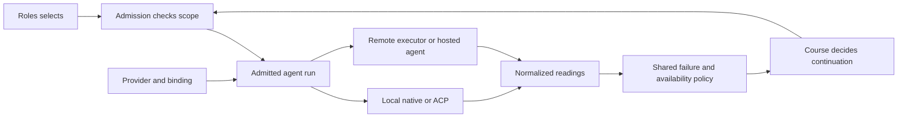

# Providers across local and remote infrastructure

**Status: accepted amendment to D213 (AGENTINFRA1, 2026-10-27; scoped owner exception under D191).** The owner confirmed the full boundary: local agent programs,
ACP and native transports, remote APIs and hosted runtimes, with their accounts, capabilities, usage and error dialects.
This extends the accepted [provider design](2026-10-26-agent-provider-design.md); its accepted migration remains the base.
It changes D125/D206's treatment of some limits and D213's process-only run preparation. The owner waived the unavailable Opus
read for this amendment; §11 records settlement and its limits under [D191](decisions/D191.md). No new runtime behavior is shipped here.

## 1. What the existing design already provides, and what is missing

D213 already places agent-specific behavior behind required provider parts and small ports, keeps transport dialects separate,
uses evidence-bound capabilities, and normalizes readings through Events. Preserve that work, its account-key compatibility and
D212's dependency map. Do not add a competing adapter registry or move orchestration policy into providers.

The gap is broader than another error pattern:

| Evidence read on main at `2342bf734` | Implication |
|---|---|
| `Agents/Adapters/Adapters.cs:1392` requires `ProcessStartInfo`; D213 §2.5 prepares a process and §2.6 leaves HTTP to another design | Opening a run needs an execution-neutral preparation result; a remote run has no local harness PID |
| `Accounts/Usage/AccountLimits.cs:108` recognizes markers and parses resets through one clause/time grammar | A provider needs its own decoder, including structured resets and recovery conditions, rather than another global grammar branch |
| `Agents/Errors/AgentErrors.cs:161` already classifies trusted failures through shared policy and provider/door tables | Extend this boundary; do not add another failure classifier in each loop |
| `Accounts/Harnesses/HarnessRoster.cs:272` turns a recognized limit into a dated cooling entry; `AccountCooling.cs:10` describes that timed store | An owner refill and an unknown reset cannot be represented honestly by a required deadline alone |
| CODEXCREDITS1 records an explicit workspace-credit refusal with no reset | Billing scope and recovery condition matter independently of the four error kinds |
| CODEXSTATUS1: `Acp.cs:1807` advertises AIR tasks but no `sessionFailure`; installed codex-acp 2.1.1 renders many failures as agent text without it | Negotiation and failure decoding belong to the selected dialect; text cannot repair a missing trusted error channel |
| CODEXWAKE1: `AcpWake.cs:68` observes tool updates as possible autonomous activity, while its end vocabulary is Claude's | Background work, a turn, and transport connectivity need distinct normalized facts; the installed causal sequence still needs proof |

Paths in this table are under `src/Daoris.Desktop/Daoris.Desktop.Driver/`. The earlier survey remains historical evidence at its own
commit; this table adds the recovery observations, without rewriting it. A narrow CODEXCREDITS1 patch reproduced the error through
the built Codex adapter and real driver looks, but is preserved separately pending this recovery design, not declared installed.

The independent Opus review requested for this proposal was itself refused before input processing by Claude Code's native result:
`is_error: true`, `terminal_reason: api_error`, `api_error_status: 429`, with a weekly-limit sentence and a stated reset. The same
result also carried `subtype: success` and `stop_reason: stop_sequence`. This is another concrete dialect case: a generic success
label cannot override the runtime's authoritative failure fields. No model tokens were reported; this is no completed foundation read.

## 2. The identities and their owners

Keep **Provider** as D213 defines it: the integration for an agent runtime, with one or more **doors**. A language-model endpoint
alone is not an agent runtime. Add infrastructure binding as an explicit dimension of that integration.

| Name | Meaning | Owned by |
|---|---|---|
| Provider | Agent runtime implementation and its declared parts | Agents' provider registry, D213 |
| Door | One supported way to interact with that runtime; existing adapter IDs remain unchanged | Provider registration |
| Transport | Frame delivery and connection lifecycle: native process, ACP connection, HTTP stream or hosted-job client | Shared transport implementation |
| Dialect | The runtime/endpoint's versioned fields, extensions, failure codes, reset grammar and lifecycle vocabulary | Selected provider and door |
| Infrastructure binding | Local process, self-hosted endpoint, gateway, or hosted agent service; configuration and reach | Machine-local connection record |
| Account pool / credential | D213's account key and selected credential reference; authentication and billing need not share a scope | Agents; secrets stay in the local credential store |
| Model / upstream maker | Requested, acknowledged and reported model; gateway and actual maker recorded separately | Roles selects; provider reports evidence |

A gateway is not automatically a second provider, a separate account, or an independent reviewer. A runtime running through a gateway
uses the same runtime integration with an explicit infrastructure binding and that endpoint's dialect. A product offering a complete
hosted agent can be a provider of its own. Never infer compatibility, shared billing or review independence from a URL or model spelling.
The existing OpenRouter-through-Claude plan is one composition; it does not define every future API integration.

An effective binding pins provider, door, infrastructure configuration revision, account, requested choice, permission/reach digest,
and the negotiated protocol and runtime versions. D213's `Known<T>` keeps source and applicability. A capability learned on another
endpoint, account, version or posture cannot widen this run. Missing support remains explicit, including a model's actual maker.

The binding also names a registered **execution composition**: executor implementation/version, transport implementation/version,
every applicable dialect implementation/version, runtime/adapter versions and credential/billing ownership. Registration validates
the combination before admission. An endpoint setting cannot select an arbitrary executor or imply a compatible dialect. Persist
the composition identity and revision on the run; a reconnect or restart uses that pinned composition or refuses it explicitly.

## 3. Contract and dependency boundary

The following names are proposed ports, not an additional monolithic interface. D213's required parts remain the composition root.



| Port / value | Input → output | Does not own |
|---|---|---|
| `PrepareExecution` | Settled selection and admitted scope → local recipe, remote connection plan, or unsupported result | Account/model selection, permission grants |
| `OpenRun` | Prepared execution, opening/resume request and delivery port → run with negotiated abilities | A fallback to another account or a fresh conversation |
| `AgentRun` | Prompt, steer, cancel-turn, stop-run, query, close; each explicitly supported or refused | Work completion, landing, quest closure |
| `IFailureDialect` | Trusted protocol/HTTP/structured-runtime failure + binding → normalized failure and optional availability restriction | Retry scheduling, account rotation, strikes |
| `IUsageQuestion` | Account/billing scope and query budget → readings or explicit unavailable/stale result | Treating absent usage as zero or an account as ready |
| `IReadingSink` | Correlated observations → D213's Events vocabulary and existing durable consumers | Provider-owned journals or invented activity |

The run is an asynchronous resource, not a `Process` wrapper. Its execution identity is a local contained process tree, or a remote
job/session identity with the declared control operations. Code outside Agents never branches on PID presence, executable name,
HTTP status, provider ID or extension key to decide behavior. Typed infrastructure and transport IDs resolve through registration.
Transport support is compiled and registered deliberately; a configuration file cannot load arbitrary code or claim capabilities.

Local recipes still pass through the existing launcher and start gate. Remote plans go through an admission gate before a request,
credential, context or workspace snapshot leaves the machine. The two paths share the settled start and observation contracts,
not a fake local process. Events' payloads remain Events' own or lower; Roles selects, Course decides continuation, Loop executes.

### Inference APIs and hosted agents

An inference API supplies model responses. To execute a Daoris quest it also needs an executor that owns the tool loop, working
repository, permission mediation, context, tool-call receipts and run lifecycle. Each registration names that executor. An integration
without one can offer inference to a declared use, but is refused for agent execution before opening a working session.

A hosted agent supplies some or all of that executor. Its provider must declare workspace preparation, artifact/change return,
task and turn identity, status query, cancellation and retention behavior. Unknown support is not emulated by pretending that
closing an HTTP connection stopped the agent. A raw HTTP/SSE transport implements delivery; it does not become an executor.

## 4. Universal failure and availability readings

Normalize **facts**, then apply **one Daoris policy**. A dialect may read a standard error envelope, authenticated service event,
declared protocol extension, structured native result or recorded error sentence. Agent-authored messages, tool stdout and an
arbitrary JSON object printed by a tool cannot classify a provider failure. Preserve phase, source, original code and dialect version
locally. Unknown fields are retained as bounded diagnostic evidence, not interpreted as another provider's dialect.

Keep D210's four classes (`limit`, `access`, `transient`, `fatal`) as the outer policy input. Add a typed restriction for a limit;
do not encode its recovery in the provider's sentence or a fifth ad hoc session state:

```text
AvailabilityRestriction
  cause: quota | rate | credit | concurrency | capacity | unknown
  subject: account | declared-shared-pool | model-on-binding | endpoint | unknown
  subjectKey: opaque local key, with evidence for any shared scope
  recovery:
    ResetAt(instant, source, stated-or-assumed-zone)
    RetryNotBefore(instant, source)
    OwnerAction(refill | sign-in | permission | change-configuration)
    Unknown
  observedAt, evidenceRef, dialectVersion, restrictionId, revision
```

`ResetAt` reports a quota reset. `RetryNotBefore` is an earliest retry hint, never a promise of available credit. `OwnerAction`
has no invented deadline. `Unknown` is a lack of knowledge, not infinity, availability, or a provider-stated hour. A provider's
decoder extracts these facts; shared policy validates them and decides whether and when another attempt is permitted.

Structured provider evidence takes precedence over that dialect's recorded text fallback. Conflicting or malformed evidence is
reported with the conflict and cannot widen availability. A past, excessive or invalid reset does not become a short retry by
clamping it silently. Store UTC instants with provenance; local display uses the machine's zone. In-process waits use the supplied
clock and cancellation. Revisions identify superseded restrictions; an old usage reply cannot clear a newer failure.

| Observation | Normalized meaning | Shared recovery |
|---|---|---|
| A recorded usage limit with a valid reset | `limit`, declared account/pool, `ResetAt` | D206 resume after that bound, or a permitted independent choice now |
| An authoritative rate/concurrency response with a retry hint | `limit`, evidenced scope, `RetryNotBefore` | Respect the hint and a shared bounded attempt budget; no nested retry loop |
| The recorded Codex workspace-out-of-credits refusal asking its owner to refill | `limit`, credit, `OwnerAction(refill)`; workspace identity unknown unless the runtime supplies one | Hold that credential; notify once; consider only another permitted choice whose restriction is not known to be shared |
| Sign-in or credential refusal | `access`, `OwnerAction(sign-in)` | Existing account refusal and owner action; no automatic sign-in |
| Provider/model capacity outage | Dialect's documented `transient`, with scope when known | D210's bounded same-conversation policy; do not cool an unrelated account |
| No recognized trusted failure evidence | Existing fatal/unknown failure with evidence | No guessed provider policy from prose |

These are proposed amendments to D125/D206/D210, not descriptions of today's implementation. In particular, today's unstated
60-minute cool-off remains the compatibility adapter for legacy **unknown timed limits** until the reviewed migration replaces
that case. It must not be applied to a positive `OwnerAction` restriction. The scheduler's next check and a provider's reset are
different fields and different UI claims.

### Scope, usage and selection

An authenticated account is not necessarily a billing unit. Several credentials can share a workspace allowance; one credential
can have model-specific limits. A shared-pool restriction propagates only through a provider-supplied relationship with evidence,
never guessed from account names or email domains. If the pool is unknown, keep it unknown and bound further failed attempts.
Do not declare another credential independent merely because it has another local profile name.

The one account rule consumes availability facts and the owner's existing ordered choices, picks, reach and spending policy.
A provider cannot rotate accounts, choose a paid model, widen a repository's allowed infrastructure, or clear an owner's hold.
Positive usage never overrides a newer restriction. Token counts, currency credit and percentage windows retain unit, scope,
measurement time and whether the report is per-turn or cumulative; absent reports remain unknown, never zero cost.

### Restriction reducer and recovery

Keep a set of independent active restrictions, not one replaceable cooling value. Admission requires **every applicable restriction**
to permit this attempt. A rate restriction never overwrites a credit hold, and an endpoint becoming healthy cannot clear a workspace
budget. Each restriction binds to its originating composition, credential identity/epoch and evidenced subject; an update or discharge
compares its expected revision. An observation for an old credential or binding cannot release its replacement.

At a reset or retry bound, policy may admit its next bounded attempt; elapsed time is not a positive reading of remaining credit.
An authoritative newer report discharges only the restriction it positively contradicts, at the matching scope and revision.
`OwnerAction(refill)` waits for a positive provider credit/budget check or the person's explicit **one-attempt** release of that named
restriction. That release leaves all other holds in force and does not mark credits restored. `Unknown` permits a bounded status
probe with no agent/tool work, otherwise needs the person's same one-attempt release; legacy unknown timed limits retain the explicit
compatibility rule above until migrated. There is no automatic model request used as a credit probe.

Refresh asks for evidence and clears no restriction by itself. Sign-in or key replacement advances the credential epoch and checks
access anew; it does not discharge an independently identified shared billing hold. *Try now* becomes a revision-bound one-attempt
release, never a bulk clear. Failure of that attempt keeps or supersedes the restriction with fresh evidence, without another release.
Retiring a binding prevents fresh use but retains the facts needed to reconcile outstanding requests and their receipts.

## 5. Lifecycle, retries and words

Use D213's normalized readings with separate facts for turn activity, background task activity, connection state and execution state.
Provider dialects translate their own terminal frames and wake origins. A terminal update for an existing tool or task alone does
not prove a new autonomous turn. A disconnect does not prove a remote run ended, and an HTTP 200 does not prove a turn succeeded.

Every attempt has the D212 move/word identities, run generation and attempt correlation. Declare whether the executor owns the
conversation, supports exact resume, acknowledges a prompt, can query a request by id, or supports idempotency. None is inferred
from using HTTP, ACP, or a particular model. Replayed frames are history; duplicate terminal readings settle one attempt once.

Before repeating a request, Course reads its disposition: never sent, acknowledged/taken, or uncertain. A request that might have
executed is queried by its provider request key where supported; otherwise hold it as uncertain. Never replay uncertain user
words or tool actions just because a stream closed. A new conversation or a briefed move remains an explicit Course decision.
Held words stay in the existing dispatcher and durable record, not a provider's memory or retry queue.

One layer owns the retry budget. Disable SDK automatic retries where supported; otherwise expose and budget their attempts before
adding Daoris's retries. Dialects report retry warnings separately from terminal failures. Cancellation interrupts waits immediately;
late output carries its old generation and cannot complete or restart a newer run. A stop's result distinguishes requested,
confirmed stopped and unable to verify. Closing a socket alone never yields confirmed stopped for a hosted run.

Accounting alone is insufficient: **every retrying layer**, including an SDK, must either have retries disabled or a verified,
bounded policy that repeats only proven-unsent operations or server-idempotent operations with the same stable key. If this cannot
be configured or established, that composition offers no automatic execution retry. Retrospective attempt counts do not authorize
replaying a request that might already have run. Provider retry hints affect scheduling, never delivery disposition.

### Durable request disposition

Failure class and delivery disposition are independent. A limit that arrives after acceptance or tool work is not proof the prompt
was refused before consumption. Existing limit-word hand-back paths (`TransientRetry.LimitRefused`, `AcpSession.HandRefused`) may
carry words again only with positive evidence of pre-acceptance rejection for that dialect and operation; the class `limit` alone
is insufficient. Taken or uncertain words remain unreplayed, even when the failure is a limit.

Extend D212's Course-owned delivery family with execution-request records for run creation and each effect-bearing operation,
linked to the existing move/word IDs, never a second queue of words. Before any network send, transactionally keep the request key,
composition/binding revision, credential epoch, run generation, operation, authorized resource scope, payload digest and attempted
state. Persist acknowledgements, remote job/request IDs and terminal receipts by expected request revision. Payload content stays
in its existing authorized home; the digest is not a substitute for preserving the words that must survive.

On restart, reconcile attempted requests before admitting a continuation: query by the saved key where the executor supports it,
or leave them uncertain for the person. Lost acknowledgement of **run creation** is also uncertain; do not create another run merely
because no remote job ID was returned. A proven-unsent request can be delivered once. The old `UncertainWords` settlement remains
the local compatibility path, but never removes the reconciliation identity of a run governed by this contract. Crash tests cover
both sides of send, acknowledgement persistence, result persistence, and a limit after accepted work.

## 6. Local ownership and access

The desktop owns accounts, credential references, browser sign-in, filesystem mediation and local paths. Shared hosts exchange
permitted records and do not become a UI host, credential relay or resolver of machine paths. Local doctrine stays offline.

Each infrastructure binding declares allowed destinations, data/repository reach, execution location, network/tool reach and the
executor that enforces access. A self-hosted endpoint is not implicitly trusted because it is on loopback or a private network.
Redirects or gateway fallback cannot carry credentials/context to a new destination outside that declared scope.

Remote work names a prepared workspace snapshot or repository identity, not a machine path. Transfer only authorized content;
keep secrets and machine-local context out by construction. A remote tool request reaches a local broker only through the run's
existing admitted capabilities, and a returned change is reviewed and applied by that repository's local owner under its gates.
Cross-repository work still travels as a quest. Providers gain no authority to publish, push, grant access, sign in or close work.

Remote tool access requires a broker grant of its own; `SessionAccess`'s short settings map and a runtime's permission prompt are
not that grant. The desktop authenticates the peer and issues audience-bound, short-lived authority naming composition, run,
generation, repository resource handles, allowed operations and permission revision. No token goes in a URL, transcript or shared
record. Each operation rechecks the current grant and revocation before admission; changed permissions, stop or a retired binding
revoke fresh calls immediately, independently of whether remote cancellation is confirmed.

The broker resolves logical resource handles locally under the admitted roots and applies the existing filesystem/command rules.
It rejects stale generations, paths supplied as authority, callbacks for another run and a reused call ID with different request
content. Keep admission and the call's receipt by call ID and payload digest before effect; repeated callbacks return its receipt.
An effect whose outcome a crash made uncertain is not executed again without reconciliation. This is not an exactly-once claim for
an arbitrary external tool. Hosted workspace/network confinement must have applicable enforcement evidence before admission;
without it the composition is unavailable for that execution scope, rather than treated as confined by its descriptor.

Requested, acknowledged and reported model/route remain separate. A gateway's hidden fallback is unknown unless it reports it,
and any reported fallback must still satisfy the admitted route; an unsuitable or unknown route cannot satisfy a review's
maker-independence claim. Record which tier actually ran where the runtime reports it, rather than deriving it from the request.

## 7. Compatibility and rollout

Do not rewrite D213's provider/door/account IDs or change its one-level `Lent` semantics as part of this extension. The local-only
path remains usable without endpoints, new keys, or model dependencies. Existing process transports keep their current behavior
behind a compatibility implementation while the new contract is proved with stand-ins.

New bindings, scoped restrictions and remote execution identities belong to versioned desktop-store families under D212, using
new tables where older builds must not read or overwrite their meaning. Do not overload `cooling.json.until` with a fake date,
an owner-action sentinel, or an endpoint ID. Old rows retain their old meaning; the migration records their source as legacy.

**Initial admission boundary: an isolated service/home, not a shared-home activation.** New remote execution and new restriction
semantics first run only there, with a distinct registry, store and service endpoint, no active-work projection into legacy session
tables, and no legacy connector or competing loop admitted. The service requires its registered runtime protocol for mutating run
operations; the owning launch configuration starts only that runtime generation. The rehearsal must deliberately attempt old
connector/loop access, not merely omit them from its setup. Normal local operation on an existing home keeps its compatibility path.

New tables alone do not keep an older driver from starting the same quest through old session/quest surfaces: the orphan sweep
can mark a remote run stopped and the ledger can then carry it on. **Shared-home activation remains unavailable in this amendment's
initial delivery.** A later foundation amendment must define and prove the exclusion mechanism against actual older statements and
binaries across active-session sweep, advance, reopen, queued starts and all non-quest run kinds before exporting these runs or
restrictions to a shared home. A new version flag older code ignores, a new table beside old executable rows, or a launch convention
alone does not prove this. No code in the initial delivery may turn on shared-home support through configuration.

## 8. Build sequence and acceptance

The dependency remains FOUNDATION1's Agents move, mod-ix. Reuse AGENTPROVIDER1's registry, census, stand-in and part-by-part cuts.
The amendment is settled in §11. Changes to recovery, remote admission and persistent semantics follow the stages below;
each behavioral change has its own failing regression and installed proof before publication.

| Stage | Concrete result | Required proof |
|---|---|---|
| A: settle this amendment | D213's accepted base plus a reviewed extension, initial isolation fixed and shared-home support unavailable | Two Codex rounds with findings checked at code lines; owner exception for the unavailable Opus read in §11; isolated old-client refusals specified |
| B: normalize availability | Provider dialect decoders and the shared restriction reducer, exercised in the isolated home | Exact Codex refusal; Claude limit; same status/different provider; concurrent restrictions; owner refill; unknown reset; stale report; shared pool |
| C: decouple execution | Process recipes and remote plans implement the same admitted run boundary | Local native/ACP parity, alternative-dialect stand-in, unsupported inference-only execution refused before send |
| D: prove remote infrastructure | Fake HTTP inference executor and hosted agent with admitted broker, no keys or real spend | Accepted work then limit, lost creation acknowledgement, duplicate call/receipt, stale callback, revocation, SDK replay refusal, cancellation not confirmed, crash/restart reconciliation |
| E: add real integrations | Each chosen provider/binding with its executor, dialect, reach and evidence | Provider-specific conformance, authorized bounded installed measurement, downgrade and local-only rehearsal |

Conformance also proves: all run kinds share failure policy; malformed/unknown extensions do not become success; actual tool
output quoting a limit never changes account availability; failure negotiation occurs only for dialects that support it;
no provider-specific IDs/keys outside declared provider vocabulary; no nested unbounded retries; no automatic move outside the
owner's role choices or reach. A fourth provider can register with a different dialect and scope without editing Course or Loop.

The installed regression cases STARTLOG1, CODEXCREDITS1, CODEXSTATUS1 and CODEXWAKE1 remain separate evidence. STARTLOG1 is already
fixed and published; the other three remain open until their complete contracts pass. Do not call a proposed interface their fix.

## 9. External evidence and limits of this proposal

Read 2026-10-27, primary documentation only; these are source claims, not live-provider measurements:

- [ACP session setup](https://agentclientprotocol.com/protocol/v1/session-setup) negotiates loading support before resume.
  Its replay requirement supports the explicit history/live distinction above; ACP alone does not establish every runtime extension.
- [ACP cancellation](https://agentclientprotocol.com/protocol/v1/cancellation) is a protocol operation. A remote transport's loss
  is not that operation's acknowledged result; each hosted runtime still needs its own cancellation evidence.
- [Claude API errors](https://platform.claude.com/docs/en/api/errors) distinguishes billing, permission, rate and overload failures;
  some spend-cap rate failures carry no retry header, and streaming errors can arrive after HTTP 200. These are API facts, not
  a claim that Claude Code forwards the same fields.
- [OpenRouter errors](https://openrouter.ai/docs/api_reference/errors-and-debugging) documents metadata identifying budget scopes,
  reset values that can be absent, and retry hints for specific failures. An ordinary credit shortage and a temporary in-flight
  budget restriction therefore need different readings. Its endpoint/error format still determines where those fields are carried.

No remote provider, real key, hosted cancellation, shared billing relationship or migration has been exercised by this document.
The installed codex-acp source and existing D213 design supplied the local dialect facts. Document gates check routing and shape,
not the proposed semantics. Both Codex rounds are recorded in §10; the Opus read was refused by a weekly limit, then waived in §11.
All managed Claude accounts were also held by recorded limits at that inspection. No early-ready override or repeated retry was made.
These were the review limits before the owner's exception and settlement in §11; existing runtime behavior remains unchanged.

## 10. Round 1 review and the proposed corrections

An independent Codex read (`gpt-6.1-sol`, high, source at `2342bf734`) asked **another foundation round**, with six findings.
The original read is preserved in private recovery evidence; this table restates its findings with repository-relative source
locations. Each cited mechanism was checked against the source before taking the finding. No code was changed by the reader.

| Finding | Source checked | Correction in this round |
|---|---|---|
| C1, critical: old-build admission unresolved | `Trees/Orphans.cs:74`, `SessionLedger.cs:1592` | §7 fixes initial isolation and excludes shared-home activation; later shared operation requires a separate proved foundation amendment |
| C2, high: executor and dialect composition not pinned | D213 design §2.4 and §12 | §2 requires a registered validated composition, implementation versions and credential/billing ownership in the durable binding |
| C3, high: restrictions have no complete recovery reducer | `AccountCooling.cs:150`, `:186` | §4 adds conjunctive independent holds, scoped revision-checked discharge, credential epochs and one-attempt releases |
| C4, high: SDK attempt counts do not authorize replay | `Acp.cs:1335`, `TransientRetry.cs:20` | §5 applies proven-unsent/server-idempotent retry requirements to every layer, refusing automatic retry when unverified |
| C5, high: failure kind conflates delivery disposition | `TransientRetry.cs:90`, `Acp.cs:1346`, `UncertainWords.cs:64` | §5 adds durable request identity before send, creation reconciliation and disposition-gated word recovery |
| C6, high: remote authority lacks a broker contract | `SessionAccess.cs:6`, `Acp.cs:2741` | §6 requires authenticated operation-scoped grants, live permission revision checks, revocation and durable duplicate-call receipts |

The code paths above are under the driver except `SessionLedger` and `SessionAccess`, under Service.Core/Sessions. These are
proposed corrections when sent for the next read, not implementation proof.

**Round 2, the same independent Codex reader:** all six findings resolved at the design level for the initial isolated scope;
no remaining concrete blocker or new blocking inconsistency identified. It reused its prior source evidence, with no further
source reads or executable checks. This is a satisfactory Codex read of the corrected design obligations, not proof they are
implemented. At that point the independent Opus read and steward settlement remained owed; §11 records the subsequent exception.

## 11. Settlement, 2026-10-27

The owner explicitly authorized lifting the unavailable review control after both blockers were identified. For this amendment
only, the required Opus foundation read is waived. No Opus model processed the proposal, and neither Codex round is counted as
another maker's read. This is the scoped exception recorded under D191, not evidence that the normal review requirement passed.

The steward accepts the amended design on the two completed Codex rounds and the source checks recorded in §10: all six
identified blockers are addressed for initial isolated operation. Implementation may proceed after mod-ix through the existing
AGENTPROVIDER1 sequence. Shared-home remote activation remains unavailable because old clients can replay work; accepting this
document does not resolve that technical incompatibility. Conformance, regression tests, installed proof and publication gates
remain required. No account restriction, command-review policy or provider permission is changed by this exception.
