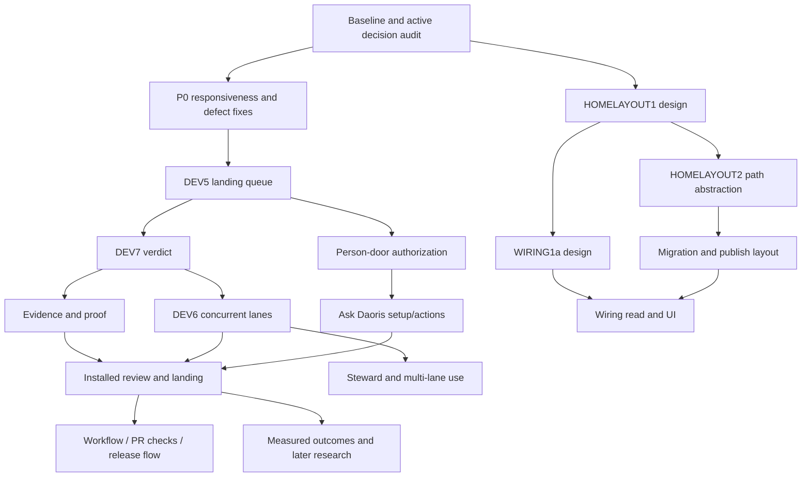

# Daoris — Unified Collaboration Architecture & Development Plan

> **Status:** Proposal for Daoris maintainer review; not an accepted ADR and not an automatic update to `TASKS.md`.  
> **Consolidation date:** 2026-10-16  
> **Sources:** Six prior proposals preserved in the appendices; current-repository observations reflected in those reviews.  
> **Core decision proposed:** Daoris should **extend Agent autonomy and collaboration**, including recursive native Subagents, without prescribing a single workflow topology.

## 0. Submitter summary / 供维护者快速阅读

This document merges previous Daoris future-direction reviews, execution-priority proposals, execution-graph exploration, collaboration RFC and recursive-subagent RFC into **one coherent proposal**. Earlier proposals are retained at the end for auditability, but **this section and Sections 1–14 take precedence** where earlier ideas conflict.

**Recommended choice:** Make a **Collaboration Fabric** the first-class substrate. A deterministic scheduler / DAG engine is an **optional consumer**, not the core ontology. Preserve the harness's native agent/subagent spawn facilities and give any participating descendant a path to discover and use Daoris tools. Existing Quest, Chain, Workflow, Session, Helper, Ask and Driver are **adapters or domain projections** over the collaboration substrate, not forced replacements.

**Immediate advice:** Correct existing landing/branch, approval, session and app-start reliability problems in parallel with a **small, separately validated collaboration-core spike**. Do not trigger a broad rewrite or stuff speculative features into the live `TASKS.md` before contract tests and maintainer approval.

### Explicitly superseded ideas

| Earlier idea | New disposition |
|---|---|
| One canonical Execution Graph determines every action | **Rejected as universal architecture.** Graphs/DAGs are useful opt-in plans and observations. |
| Scheduler assigns all Agent work | **Rejected as required behavior.** Agent-to-agent negotiation, native delegation and self-directed coordination must work. |
| A single Mission/DAG engine is mandatory | **Deferred.** Add only for concrete use cases unmet by existing Quest/Chain/Workflow. |
| Only Daoris-spawned root agents are participants | **Rejected.** Harness-native Subagents and descendants must be discoverable/connectable. |
| All native harnesses provide equivalent subagent telemetry | **Rejected.** Support capability/visibility levels and honest degradation. |
| Every suggestion in the old 73-item list is a new feature | **Rejected.** Many are existing, partially built or intentionally held; use owner-facing backlog decisions. |

## 1. Mission and design principles

**Mission:** Enable people, Daoris-launched agents, harness-native Subagents, external agents and automation tools to collaboratively accomplish engineering goals across sessions, repositories and runtimes.

1. **Collaboration is open-ended.** An Agent may consult, negotiate, split, delegate, hand over, form a temporary group or continue independently; it need not start from a prescribed DAG.
2. **Recursive participation.** Any descendant of a Claude Code, Codex or compatible agent should have an integration path, whether or not Daoris created it.
3. **Harness-native first.** Do not replace vendor spawning, context management or reasoning. Daoris adds interoperability and durable shared facilities.
4. **Separate ancestry, collaboration and ownership.** Parentage does not imply who may be contacted or who owns a repository/Quest.
5. **Capability ≠ authority.** Knowing about a tool and being permitted to perform an external action are different. Resource access is enforced at the actual executor/gateway, not by model text.
6. **Agent judgment, deterministic infrastructure.** Agents choose strategies; Daoris supplies identities, discovery, routing, durable messaging, artifact references, observability and reliable effect boundaries.
7. **Partial visibility is normal.** An opaque native Subagent is still useful; do not fabricate events, lineage or guarantees.
8. **Small contracts before big frameworks.** Prove common interoperability with two harnesses before creating a DSL, global event-sourcing mandate, or elaborate role hierarchy.
9. **Respect current source of truth.** `TASKS.md` holds open work and prerequisites; `docs/task-archive.md` records completion; `ROADMAP.md` describes intent; decisions/acceptance contracts supersede broad proposals.

## 2. Architecture: collaboration substrate, not universal scheduler

```text
                        Human / Goal / Ask
                              |
                    Collaboration Space
                              |
      +-----------------------+-----------------------+
      |                       |                       |
 Claude Code Root         Codex Root           Daoris Helper
      |                       |                       |
  native subagent        native subagent        external agent
      |                       |                       |
 nested descendants      descendants                |
      +-----------------------+-----------------------+
                              |
                   Daoris Capability Gateway
                              |
         +----------+---------+----------+----------+
         |          |         |          |          |
      Identity   Messaging  Knowledge  Artifacts  Quest/Work
         |          |         |          |          |
         +----------+---------+----------+----------+
                              |
                      Durable collaboration
                              |
              Optional Workflow / DAG / Scheduler
                              |
                 Existing Driver / Tool / Plugin
```

There are **three graphs**, potentially at different completeness levels:

- **Spawn tree** — native parent/child lifecycle, if exposed by harness.
- **Collaboration graph** — peer messages, consults, delegations, reviews, subscriptions and shared artifacts; cross-tree/cross-harness.
- **Ownership / commitments graph** — repositories, domains, Quest/assignments and accepted responsibility; persists beyond agent process lifetimes.

No automatic equivalence among these graphs. A child does not automatically inherit parent ownership, write permissions or account credentials.

## 3. Minimal shared concepts

| Primitive | Semantics | Persistence |
|---|---|---|
| `Goal` | Human or Agent's objective; can evolve | Durable |
| `CollaborationSpace` | Shared scope for participants, messages and artifacts | Durable |
| `Participant` | Human, Agent, Subagent or service with explicit Daoris identity | Durable identity for participation; runtime ephemeral |
| `RuntimeBinding` | Current native session/agent alias, harness, discovery provenance | Versioned; may disappear |
| `Message` | Routed, correlated request/reply/notice | Durable, deduplicatable |
| `Commitment` | Accepted responsibility, handoff, decline or renegotiation | Durable |
| `Artifact` | Referenced plan, diff, finding, context or proof | Durable reference, access-controlled |
| `Relationship` | Spawn, consult, delegate, review, depend-on, own, etc. | Versioned with provenance |
| `Capability` | Operation surfaced to participant, with separate authorization | Scoped and revocable |
| `ExecutionBinding` | Existing driver/harness session that performs actual effects | Observable, recoverable where possible |

**Do not consolidate away** existing Quest/Chain/Workflow meanings in one migration. Instead establish stable mappings and test whether they preserve behavior.

### Participant identity (illustrative)

```ts
type Participant = {
  id: string;
  spaceId: string;
  kind: 'human' | 'agent' | 'service';
  parentId?: string;                 // known native spawn ancestry only
  rootId?: string;
  harness?: string;
  nativeSessionId?: string;
  nativeAgentId?: string;
  discovery: 'hook' | 'event' | 'tool-registration' | 'manual' | 'inferred';
  connectivity: 'opaque' | 'observed' | 'connected' | 'federated';
  lifecycle: 'discovered' | 'active' | 'finished' | 'lost';
};
```

Opaque native identifiers must be namespaced by harness and parent session; inferred parentage should be explicitly marked unknown rather than invented. Discovery is **not** authentication.

## 4. Native Subagent integration — first-class requirement

A top-level Daoris agent can spawn harness-native Subagents; those can spawn descendants if the harness supports this. They should gain Daoris capabilities by two **independent** channels:

**A. Tool/capability integration (primary)** — MCP or a harness-native tool surface exposes Daoris collaboration functions. Where inherited by descendants, tools become naturally available; where not inherited, an adapter attaches supported tools during native initialization. Do not silently claim inheritance without a harness/version-specific test.

**B. Native events/hooks (secondary)** — observe spawn/start/finish/failure and correlate native IDs, progress and results where the harness supports them. Hooks alone do not prove that a Subagent can use tools; no event does not prove that no Subagent exists.

### Capability levels

| Level | Daoris visibility | Subagent value |
|---|---|---|
| L0 Opaque | Parent and final result only | Continue native work; link result to parent |
| L1 Observed | Some lifecycle and native IDs | Show known ancestry/progress truthfully |
| L2 Connected | Tool registration + participant identity | Knowledge/context, messages, artifacts |
| L3 Federated | Cross-root communication | Consult, delegate, coordinate across trees/harnesses |
| L4 Recoverable | Durable correlation + handoff | Replacement session resumes responsibility, not hidden model state |

These are capability states, not a promise that any provider supports all levels. Validate Claude Code, Codex and ACP independently and record version-specific observations.

### Suggested gateway operations

```text
daoris.me
 daoris.discover_participants
 daoris.search_knowledge
 daoris.get_context
 daoris.send_message
 daoris.receive_messages
 daoris.request_help
 daoris.delegate_work
 daoris.publish_artifact
 daoris.read_artifact
 daoris.propose_quest
 daoris.claim_commitment
 daoris.report_progress
```

The list is a **proposed facade**, not an assertion that these commands exist today. Register tools for native Subagents without intercepting/replacing `spawn_agent`, Claude `Agent`/`Task` semantics or other harness internals.

### Critical behaviors

- A Claude Subagent can discover a Codex Subagent and consult directly when both are connected and belong to an authorized collaboration scope.
- A Subagent can publish an artifact directly and refer to it from a message or Quest, without relaying a full chat transcript through its root.
- A parent dying does not automatically erase accepted commitments or artifacts; recovery transfers work deliberately.
- A Subagent may use a Daoris Quest to request another repository owner's help, but does not gain permission to write that repository merely by communicating.
- Cancellation and revocation have explicit descendant semantics even when native harness cancellation is partial or unavailable.

## 5. Context sharing should be reference-based

Avoid pushing whole conversations into every descendant. Supply compact collaboration references:

```json
{
  "spaceId": "space-1",
  "participantId": "participant-7",
  "goalRef": "goal-2",
  "assignmentRef": "commitment-9",
  "contextRefs": ["decision-3", "artifact-11"],
  "replyTo": "participant-1"
}
```

Participants fetch authorized context as needed. A future **Context Compiler** can select and explain the effective doctrine, repo intelligence, decisions and artifacts; it should remain inspectable and avoid opaque memory injection. Track which reference was used, not just which model saw an enormous blob.

## 6. Messaging, delegation and result exchange

Core protocol should support:

- Directed message to participant, role/capability, Quest assignee or topic.
- Correlation ID, causal parent ID, idempotency key, delivery status and explicit expiry where appropriate.
- Request/response, notification, proposal, invitation, accept/decline, escalation and handoff.
- Dynamic delegation and reassignment, without imposing a tree-constrained communication route.
- Durable artifacts: code diff/commit ref, design note, context note, verification evidence, structured result.
- Offline/restart behavior: pending messages survive; duplicates do not produce duplicate external effects.

Illustrative envelope:

```json
{
  "id": "msg-01",
  "spaceId": "space-1",
  "from": "participant-7",
  "to": { "participantId": "participant-22" },
  "kind": "request",
  "subject": "Review API contract",
  "correlationId": "conversation-5",
  "causationId": "msg-00",
  "artifactRefs": ["artifact-11"],
  "idempotencyKey": "review-contract-42"
}
```

**Delivery caveat:** connected does not imply always-on. Poll/inbox, pull-on-tool-call, adapter push and native event forwarding are optional strategies. UI must distinguish queued, acknowledged, delivered-to-tool and acted-upon; do not promise real-time reachability where no harness supports it.

## 7. Trust and effect boundaries without curtailing collaboration

Daoris should maximize **who can collaborate** while maintaining explicit control over **who can affect resources**. These are complementary goals.

- Gateway validates session-bound principal, workspace membership, scopes and actual grants.
- Descendants do not silently inherit private keys, publishing rights, production access or parent account secrets.
- Cross-repo **discussion** and requests can be open within a space; cross-repo **writes** still honor ownership and execution grants.
- A participant can propose work without holding the capability to execute it.
- Consent, credentials, spending, publishing and sensitive irreversible operations remain person-gated where current contracts require it.
- Enforce checks at tool/executor boundaries; prompts and graph topology are not security enforcement.
- Audit real grants, denials and revocations, not merely policy text.

## 8. Relationship to existing Daoris modules

| Existing surface | Proposed relationship | Migration posture |
|---|---|---|
| Ask Daoris | Human/agent intent entry point and collaboration interaction | Preserve; add capability operations |
| Quest | Cross-repository request/ownership unit | Keep; expose as commitment/work relationship |
| Chain | Current work decomposition / continuity | Adapt as one collaborative structure, not universal law |
| Workflow | Optional prescribed routine | Keep existing semantics; later opt-in graph view |
| Session | Runtime instance of work/participant | Keep; add binding and durable handoff references |
| Helper / Second opinion / Co-working | Existing collaboration features | Normalize messages, artifacts and identity incrementally |
| Driver | Launch/execute/observe adapter | Reuse; do not rewrite for framework purity |
| Knowledge / Doctrine | Shared information and rules | Expose reference-based retrieval via gateway |
| Plugin / MCP | Capability connection surface | Reuse with per-harness attachment testing |
| Evidence / Landing | Effect verification and integration | Preserve independent acceptance/authorization |
| Code Map / Repository registry | Ownership and impact facts | Feed discovery and context; do not make a gate for every dialogue |

No second set of authoritative Quest or Session states should emerge. Add event/projection mapping only where it solves measured inconsistencies; define which existing table/service remains canonical during rollout.

## 9. Practical correctness issues must remain P0

Architecture work is not a reason to defer actual faults. From the October 16 execution plan, first reconcile open status in `TASKS.md` and archive, then prioritize:

1. **Landing / branch lineage correctness** and duplicate-merge safeguards; honor the task prerequisites `DEV5 → DEV7 → DEV6` rather than implementing uncontrolled lanes first.
2. **Approval propagation / helper launch** (`HELPERYES1`, `PERSONDOOR1*` as applicable); ensure one permission response cannot be lost or auto-escalated.
3. **Installed-app/process responsiveness** (`SWEEPFLIGHT1`, `PROCSTART2`, `MAINWINDOWS2`, `SERVICEHOME2`, `TWINSTOP1`, `REALHOSTPORT1`, `FLAKE4` — only where still open).
4. **Evidence/landing/provenance** (`EVID1*`, `EVID2*`, `LAND2*`, `TRACE1c` with their own prerequisites).
5. **Daily UX and setup** (`LAYOUT8b/c`, `WSSETUP14*`, `HELPOWED1`, `HELPPLUG1*`, `HOMELAYOUT1–4`, `WIRING1a–e`, subject to current TASKS).
6. **Co-working lifecycle** (`HELPERTERM1`, `WAITFOOT1e`, `WAITCOUNT1`, `MIXAGENT1c`, `MIXAGENT3a-iii`, `COWORK1`, `SESSONE2i`, `MSG1d2`, `HANDWORDS1-ii`, subject to status).

**Task IDs above are historical references from the source review, not a statement that every one remains open.** Re-read current `TASKS.md` and `docs/task-archive.md` before assigning implementation.

### This changes the old execution plan in one crucial respect

The prior plan said “do not add another orchestration system” as if that settled architecture. Revised interpretation:

> Do not add a **competing all-powerful workflow engine**, but **do** introduce the smallest common collaboration protocol needed to avoid fragmenting Quest/Chain/Helper/Workflow/Subagent interactions.

These goals are compatible: urgent correctness work stays urgent, while small foundational experiments run in isolation.

## 10. Phased architecture plan with exit criteria

| Phase | Work | Measurable exit / proof | Dependencies |
|---|---|---|---|
| **C0 Contract audit** | Inventory Quest/Chain/Session/Helper/MCP native spawn and current source-of-truth states | Matrix of actual behaviors, omissions, vendor versions and authoritative state owners | None; parallel to P0 bugfixes |
| **C1 Identity spike** | Participant/runtime-binding model and observed-vs-connected distinction | Nested native Subagent discovered with honest lifecycle, no fabricated identity | C0 |
| **C2 Capability gateway** | Expose read-only `me`, knowledge/context and artifact read to connected native Subagent | Claude/Codex evidence for actual inheritance or fallback, permission-denial tests | C1 |
| **C3 Messaging/artifacts** | Durable direct cross-tree messages and published artifact refs | Restart/dedup test, nested-to-cross-harness round trip, no full-transcript relay | C2 |
| **C4 Commitment/delegation** | Request help, accept/decline, handoff and Quest adapter | Native Subagent delegates; ownership and authorization remain correct | C3 |
| **C5 Feature integration** | Refactor Helper/Co-working/Ask/Workflow projections onto shared primitives | Existing contract tests pass; no duplicate canonical Quest/Session state | C4 |
| **C6 Recovery/scale** | Parent-loss behavior, leases, backpressure, visualizations, optional remote participants | Crash/reconnect/cancel/revoke tests, truthful partial-visibility UI | C5 |
| **C7 Opt-in advanced planning** | DAG/Mission, parallel groups or adaptive planners where actual users need them | Demonstrated scenario that prior primitives cannot solve cleanly; opt-in, not default | C5 + evidence |

**Critical path:** C0 → C1 → C2 → C3 → C4. Keep a vertical slice small: one root, one native descendant, one Daoris helper, one cross-tree message, one artifact, one delegated action. Do not require a fully general scheduler to ship that slice.

### Work that can run in parallel

- Current narrowly scoped P0 fixes in isolated branches/worktrees.
- C0 inventory and read-only architecture test fixtures.
- Vendor adapters measured independently without altering shared Driver state-machine files.

### Work to serialize

- Shared Driver / Quest/Session persistence schema changes.
- Landing Queue, verdict and merge-behavior changes.
- Central auth/person-door, shared capability enforcement and cross-agent message dispatch.

Use repository's branch/merge procedure (`tools/merge-branch.mjs` where applicable); do not introduce competing merge automation.

## 11. Ten architecture canaries

1. **Native spawn preserved:** Claude root launches native Subagent; normal native behavior remains intact.
2. **Recursive observation:** Descendant-of-descendant can be represented if surfaced; unknown lineage remains unknown otherwise.
3. **Capability availability:** Subagent successfully calls Daoris knowledge through its real tool channel (not parent simulation).
4. **Cross-tree consultation:** Native Claude Subagent sends a question to Codex Subagent/helper and receives a correlated reply.
5. **Artifact exchange:** Agent B reads an artifact published by Agent A without copying whole conversation history.
6. **Dynamic delegation:** A descendant requests and transfers bounded responsibility to another participant; accept/decline/reassign persists.
7. **Recovery:** Parent terminates; messages/artifacts/commitments remain and a replacement participant can continue transparently.
8. **Authorization separation:** Participant can ask another repo for help but cannot directly write it without a grant.
9. **Partial vendor visibility:** Unsupported native lifecycle events produce an honest `opaque/partial` status, not fake full monitoring.
10. **Regression safety:** Existing Quest, Chain, Workflow, landing, evidence, helper and account/session behavior stays working across restart and installed UI.

For each canary record: harness and version, OS, integration channel, native event evidence, tool-call evidence, acceptance result, missing signals and outstanding manual steps. **Unit mocks alone do not prove vendor-native Subagent integration.**

## 12. Near-term backlog decisions to request from maintainer

Decide these as **architecture tasks**, not as 50 newly invented implementation tickets:

- **ADR-A:** Approve Collaboration Fabric as the substrate and classify DAG/Workflow as optional patterns.
- **ADR-B:** Approve `Participant`/`RuntimeBinding` identity and explicit visibility levels.
- **ADR-C:** Select initial capability transport (MCP first, with native adapter fallback) and exact supported vendor versions.
- **ADR-D:** Define messaging persistence / correlation / acknowledgement semantics and existing source-of-truth compatibility.
- **ADR-E:** Define who holds long-lived Quest responsibility when root/subagents disappear; establish handoff semantics.
- **ADR-F:** Define credential and permission scopes for nested/cross-harness participants.

Then create **only the C0–C2 vertical slice** in `TASKS.md`; hold C3–C7 until contract tests justify them.

## 13. Follow-on improvements, ranked against this foundation

| Theme | Benefit | Decision |
|---|---|---|
| Cross-entity Engineering Ledger / trace | Intent → participant → action → diff/evidence/landing causality | Build thin read model atop current records; avoid duplicate write authority |
| Evidence contracts and independent verification | Objectively validate work, separate proposer and verifier | Deepen existing EVID/LAND design, not a fresh subsystem |
| Context Compiler / explain | Reliable knowledge for roots and descendants | Add after reference-based retrieval; measure context use |
| Repository briefs/contract graph | Improve cross-repo collaboration and impact discovery | Build on existing repository map/code intelligence |
| Failure taxonomy / incident-to-doctrine | Learn from repeated failures | After reliable provenance and evidence |
| Outcome metrics / routing | Improve agent choice with observed performance | After trustworthy success/failure labels; do not bake in brand heuristics |
| Environment and session replay | Reproducible failed runs and handoffs | Recover engineering state, not model hidden state |
| Tool/plugin supply-chain checks | Keep expanded gateway safe | Incremental; require checks before untrusted distribution |
| Remote/headless workers | Broader collaboration topology | Later, preserve same participant/gateway semantics |
| Parallel lanes / graph editor / Mission | Useful opt-in work plans | Later, only after current landing and runtime reliability |

### Ideas to intentionally postpone

- Universal autonomous coordinator that decides all actions.
- Requirement that every Agent speak a proprietary Daoris-only spawning protocol.
- Full replacement of native Claude/Codex toolchains or model-provider abstraction.
- Global all-purpose CI/CD, IDE, project tracker, memory framework or plugin runtime.
- Speculative multi-agent swarms before evidence of benefits and merge safety.
- Premature organization-wide IAM, marketplace or remote orchestration complexity.

## 14. Implementation review checklist

Before accepting a PR under this proposal, answer:

- [ ] Does it increase available Agent collaboration or only centralize control?
- [ ] Can a harness-native Subagent use it without Daoris spawning that Subagent?
- [ ] Can it degrade honestly when native event/tool support is missing?
- [ ] Does it preserve native behavior and the existing Quest ownership boundary?
- [ ] Does it distinguish discovery, identity, capability and authority?
- [ ] Can collaborators exchange structured artifacts and work without full transcript copying?
- [ ] Does it preserve permissions for actual side effects and person-only operations?
- [ ] Are messaging and work claims idempotent, correlated and recoverable?
- [ ] Are design claims backed by observed test evidence, not just mock compatibility?
- [ ] Is the change integrated with existing Daoris sources of truth rather than duplicating them?

---

## Appendix — original proposals (historical reference only)

The following appendices retain the six previous Markdown artifacts **verbatim** to avoid losing technical detail or earlier task references. They contain exploratory ideas that may conflict with the consolidated decisions above. **Do not interpret historical appendices as approved implementation requirements.**

<details>
<summary><strong>Appendix A — Original broad future directions, 73 candidate themes (DAORIS_FUTURE_DIRECTIONS.md)</strong></summary>

---

# Daoris — Future Directions & Improvement Proposal

> Status: Proposal  
> Scope: Post-current-roadmap evolution  
> Goal: Evolve Daoris from an **AI-native engineering control plane that can drive work** into one that can **prove, learn from, recover, optimize, and safely scale that work**.

---

## 0. Current Position

Daoris already has a surprisingly complete control-plane foundation:

- canonical engineering doctrine and packs
- repository adoption, sync, drift detection, and upstreaming
- workspace-based repository families
- repository ownership/domain declarations
- cross-repository quests
- local and shared knowledge services
- desktop driver and session execution
- Claude Code / Codex / ACP-based harness support
- multiple agent accounts and profiles
- toolchain pinning
- permissions and trust boundaries
- session conversations and structured events
- plugins
- workspace topology / Map
- intake → quest → session → verify/report workflow
- local-first + remote synchronization

That means the next major opportunity is **not simply adding more agent adapters**.

The next phase should strengthen five properties:

```text
Can Daoris drive work?
        ↓ already largely solved

Can Daoris prove that the work is correct?
Can Daoris understand why work succeeded or failed?
Can Daoris recover safely when execution goes wrong?
Can Daoris improve future execution from previous work?
Can Daoris coordinate larger engineering programs without becoming opaque?
```

A useful target identity is:

> **Daoris = Engineering Control Plane + Evidence System + Learning Loop**

---

# 1. Evidence-First Completion

## Problem

An agent saying:

> "Done"

is not the same as the work being complete.

Even if repository gates pass, completion may require evidence that exists outside the repository:

- browser behavior
- screenshots
- API responses
- performance results
- database migrations
- deployment state
- user acceptance criteria
- cross-repository compatibility
- issue/ticket expectations

Daoris already owns the lifecycle of a Quest, so it is the correct layer to own the definition of **what evidence is required before a Quest can become complete**.

## Proposal: Evidence Contracts

Extend a Quest with machine-readable acceptance evidence:

```json
{
  "acceptance": [
    {
      "type": "gate",
      "name": "tests"
    },
    {
      "type": "browser",
      "assert": "login flow reaches dashboard"
    },
    {
      "type": "artifact",
      "path": "docs/api-diff.md"
    },
    {
      "type": "human",
      "prompt": "Confirm the new interaction feels correct"
    }
  ]
}
```

Possible evidence types:

- `gate`
- `test`
- `browser`
- `command`
- `artifact`
- `diff`
- `api-contract`
- `performance`
- `deployment`
- `human`

## Desired lifecycle

```text
Quest
  ↓
Agent work
  ↓
Candidate completion
  ↓
Evidence collection
  ↓
Verification
  ├── pass → Done
  └── fail → Resume / New Quest / Human review
```

## Important rule

**The model should not be the authority that declares its own success.**

The session may propose completion.

Daoris should determine whether the declared evidence exists.

## Priority

**P0 / Very High**

This makes every later feature more trustworthy.

---

# 2. Execution Provenance / Engineering Ledger

## Problem

Daoris already records sessions, accounts, agent versions, quests, and conversations.

The natural next step is to make every engineering change reconstructable.

For any commit or resulting diff, Daoris should be able to answer:

```text
Why did this change exist?
Which Quest requested it?
Which intake created the Quest?
Which repository owned it?
Which agent performed it?
Which account/profile was used?
Which agent/tool version was used?
Which doctrine version governed the session?
Which permissions were granted?
Which gates ran?
What evidence caused it to be accepted?
Which human decisions changed the run?
```

## Proposal: Engineering Ledger

Introduce an immutable logical record:

```text
Intent
  ↓
Intake
  ↓
Quest
  ↓
Session
  ↓
Tool calls / actions
  ↓
Diff
  ↓
Verification evidence
  ↓
Commit / PR / release
```

Example:

```json
{
  "questId": "Q-1042",
  "sessionId": "S-992",
  "repository": "Shenora",
  "agent": "claude-code",
  "agentVersion": "2.x",
  "profile": "work",
  "doctrine": "daoris@0.0.x",
  "baseCommit": "abc123",
  "resultCommit": "def456",
  "gates": [...],
  "evidence": [...],
  "decisions": [...]
}
```

This should be queryable from both directions:

```text
Quest → code

code → why was this changed?
```

## Future integration

Eventually:

```bash
daoris trace <commit>
daoris trace <file>
daoris trace <quest>
```

## Priority

**P0 / Very High**

This could become one of Daoris's strongest differentiators.

---

# 3. Replayable Sessions

## Problem

Agent systems are difficult to debug because their runs are partially nondeterministic.

When a task fails, it is often difficult to distinguish:

- bad prompt/context
- wrong repository routing
- wrong permissions
- tool failure
- environment difference
- changed agent version
- model behavior
- stale code state
- missing knowledge

Daoris already pins many of these variables.

That puts it in an unusually good position to implement **engineering replay**.

## Proposal

A session record should contain enough information to reconstruct its execution envelope:

```text
base commit
repository
quest
agent
agent version
profile identity reference
tool versions
doctrine version
permissions
environment declaration
MCP/plugin declarations
input context references
human interventions
```

Command:

```bash
daoris replay <session>
```

Modes:

```text
--inspect
    reconstruct without running

--fork
    create a new session from the old starting state

--same-tools
    require original tool versions

--latest-tools
    reuse intent but run against current tools
```

## Why this matters

This turns failures into reproducible engineering incidents rather than chat transcripts.

## Priority

**P1 / High**

---

# 4. Session Checkpoints and Recovery

## Problem

Long-running agent work will eventually fail because of:

- process crash
- laptop restart
- rate limits
- corrupted worktree
- network failure
- tool crashes
- permissions requiring human intervention
- agent context exhaustion

Restarting from zero wastes both tokens and reasoning.

## Proposal: Execution Checkpoints

Daoris should define checkpoints at meaningful state transitions:

```text
Session started
↓
Repository inspected
↓
Plan accepted
↓
First change landed
↓
Tests passing
↓
Verification started
↓
Candidate complete
```

Checkpoint data should not attempt to serialize hidden model state.

Instead preserve **engineering state**:

```text
git tree
session events
current quest state
known findings
remaining acceptance criteria
tool state references
pending questions
```

Recovery:

```bash
daoris session resume <id>
```

or:

```text
Original session unavailable
       ↓
New agent session
       ↓
Receives Recovery Brief
       ↓
Continues from checkpoint
```

## Recovery Brief

Generated deterministically from recorded state:

```markdown
# Recovery Brief

Quest:
...

Completed:
- ...

Evidence:
- ...

Remaining:
- ...

Current tree:
...

Known constraints:
...

Do not repeat:
- ...
```

## Priority

**P1 / High**

---

# 5. Agent Outcome Evaluation

## Problem

Usage measurement tells Daoris:

```text
how much an agent consumed
```

but not:

```text
whether it was effective
```

Daoris should eventually know:

- completion rate
- retry rate
- gate failure rate
- human intervention rate
- time/token cost
- regression frequency
- average quests reopened
- repository-specific success
- task-type-specific success

## Proposal: Outcome Metrics

Per completed Quest:

```text
agent
agent version
profile
repository
task category
duration
usage
number of retries
human interventions
verification failures
final acceptance
reopen within N days
```

Then calculate:

```text
Success / Cost
Success / Token
Success / Session
First-pass verification rate
Mean retries
Human intervention rate
```

## Important boundary

Do **not** reduce this to a universal "agent score".

An agent may perform differently by domain:

```text
Claude
  architecture      strong
  browser workflow  medium
  repetitive edits  expensive

Codex
  repetitive edits  strong
  repo discovery    different profile
```

Selection should be contextual.

## Priority

**P1 / High**

---

# 6. Evidence-Based Agent Routing

Once outcome measurements exist, Daoris can improve routing.

Today:

```text
Quest
  ↓
configured agent
```

Future:

```text
Quest
  ↓
Task characteristics
  ↓
Historical outcomes
  ↓
Available accounts
  ↓
Cost / usage constraints
  ↓
Agent selection
```

Example routing facts:

```json
{
  "repository": "Daoris.Service",
  "taskType": "dotnet-refactor",
  "preferredAgent": "codex",
  "reason": {
    "sampleSize": 23,
    "firstPassRate": 0.87
  }
}
```

## Critical design principle

Daoris should select from **measured engineering outcomes**, not from model-brand assumptions.

It should also remain explainable:

> Selected Codex because the workspace policy allows it and its last 20 similar quests had fewer verification retries.

## Priority

**P2 / Medium-High**

Depends on outcome measurement first.

---

# 7. Repository Intelligence 2.0

Repository intelligence is already on the roadmap.

This area can become much more important than a visual graph.

The goal should not be:

> draw the repository.

The goal should be:

> make structural facts available to routing, impact analysis, verification, and agents.

## Suggested layers

### 7.1 Symbol Graph

```text
class
function
interface
module
project
package
```

Relations:

```text
calls
implements
inherits
imports
publishes
consumes
```

### 7.2 Contract Graph

Extract externally meaningful contracts:

```text
HTTP routes
events
messages
database schemas
public interfaces
CLI commands
configuration schemas
```

### 7.3 Change Impact Graph

Given:

```text
change X
```

answer:

```text
What may break?
Which repositories depend on this?
Which tests are relevant?
Which quests may need to be generated?
```

### 7.4 Ownership Graph

Combine code structure with repository declarations:

```text
symbol → module → repo → domain owner
```

### 7.5 Semantic Architecture Layer

Allow repositories to annotate structural nodes:

```text
"This service owns recipe aggregation."
"This endpoint is legacy."
"This module may not depend on UI."
```

## Priority

**P1 → P2**

Repository intelligence should be treated as infrastructure, not UI decoration.

---

# 8. Cross-Repository Change Plans

## Problem

Quest is a good ownership boundary.

But some features intentionally require several repositories.

Example:

```text
Backend API change
↓
SDK update
↓
Frontend update
↓
Desktop integration
```

Independent quests are not enough; the overall change has ordering and compatibility constraints.

## Proposal: Change Plan / Mission

Introduce an orchestration layer above Quest.

Possible terminology:

```text
Goal
Mission
ChangeSet
Program
```

Suggested model:

```text
Mission
  ├── Quest A: API
  ├── Quest B: SDK
  │      dependsOn A
  ├── Quest C: Web
  │      dependsOn B
  └── Quest D: Integration verification
         dependsOn A,B,C
```

Example:

```yaml
mission: Add live inspection
quests:
  - id: api
    repo: backend

  - id: client
    repo: sdk
    after: api

  - id: ui
    repo: web
    after: client

  - id: verify
    type: verification
    after: [api, client, ui]
```

## Important boundary

A Mission coordinates ownership.

It must **not** erase repository ownership.

Every modification should still happen inside the owning repository's Quest/session.

## Priority

**P1 / High**

---

# 9. Contract-Driven Cross-Repo Changes

For multi-repository work, use explicit interface contracts.

Example:

```text
Producer repository
     ↓
Contract change
     ↓
Consumers
```

Daoris can detect:

```text
OpenAPI diff
protobuf diff
event schema diff
NuGet/npm package API diff
public .NET API diff
database migration contract
```

Then:

```text
Breaking contract detected
        ↓
Find dependent repositories
        ↓
Create / propose dependent Quests
```

Example:

```text
Backend removes field X
        ↓
Daoris knows:
  web consumes X
  desktop consumes X
        ↓
2 follow-up quests proposed
```

## Priority

**P2 / Medium-High**

High strategic value after repository intelligence exists.

---

# 10. Workspace-Level Invariants

Today repository gates protect repositories.

Some rules, however, belong to the entire workspace.

Examples:

```text
all public APIs must remain backward compatible

frontend cannot directly call internal-service-x

all repositories must use the same protocol schema version

a release cannot contain mixed package versions

service A and service B must pass compatibility tests together
```

## Proposal

```text
workspace gates
```

Example:

```json
{
  "workspaceGates": [
    {
      "name": "api-compatibility",
      "runner": "..."
    }
  ]
}
```

Run at Mission verification / integration stage.

## Priority

**P2**

---

# 11. Human Decision Objects

Humans currently appear mainly as interruptions or approvals.

Daoris should make important human decisions explicit artifacts.

Examples:

```text
"Use SQLite, not Postgres."
"Do not modify the public API."
"Ship without migration support."
"Accept this known limitation."
```

## Proposal

A decision object:

```json
{
  "decisionId": "D...",
  "scope": "quest|repository|workspace",
  "statement": "...",
  "reason": "...",
  "madeBy": "human",
  "expires": null
}
```

Agent sessions receive relevant active decisions automatically.

This prevents the classic failure:

```text
Person tells Agent A something
Agent A finishes
Agent B starts tomorrow
Decision is gone
```

## Useful extension: expiry

Some decisions are temporary:

```text
"Do not update React until release X."
```

Allow:

```text
expiresAt
supersededBy
```

## Priority

**P1**

---

# 12. Knowledge Provenance and Confidence

Daoris already indexes repository knowledge and detects convergence.

The next step is to distinguish different kinds of "knowledge".

Not all knowledge is equally authoritative.

Example:

```text
Architecture decision
Production incident finding
Agent observation
README statement
Old task note
Human instruction
Generated hypothesis
```

## Proposal

Every knowledge item should carry provenance:

```json
{
  "sourceType": "decision",
  "source": "docs/decisions/D73.md",
  "commit": "...",
  "observedAt": "...",
  "authority": "repository",
  "status": "active"
}
```

Possible states:

```text
observed
proposed
verified
accepted
deprecated
superseded
contradicted
```

## Why this matters

Without provenance, a knowledge system eventually becomes a confident pile of stale statements.

## Priority

**P1 / High**

---

# 13. Knowledge Contradiction Detection

Convergence answers:

> Two repositories discovered the same thing.

The opposite problem is equally valuable:

> Two authoritative sources disagree.

Examples:

```text
Repo A:
"All IDs are UUID."

Repo B:
"Customer IDs are numeric."
```

or:

```text
Decision D14:
"Use X."

New architecture document:
"Use Y."
```

Daoris should detect potential contradictions and present them for review.

```text
Knowledge
  ├── convergence
  ├── duplication
  └── contradiction
```

Do not auto-resolve.

Human disposition:

```text
different scope
one stale
both valid
supersede
needs investigation
```

## Priority

**P2**

---

# 14. Knowledge Decay / Freshness

Knowledge should not live forever without challenge.

Add a freshness system based on evidence, not arbitrary TTL.

Potential decay signals:

```text
source file removed
owning code changed heavily
API contract changed
decision superseded
repository no longer exists
knowledge has not been observed since major refactor
verification repeatedly contradicts it
```

Daoris may mark:

```text
Fresh
Possibly stale
Stale
Superseded
```

This should remain advisory unless tied to a deterministic invariant.

## Priority

**P2**

---

# 15. Context Compiler

## Problem

As Daoris accumulates:

- doctrine
- repository knowledge
- workspace knowledge
- Quest details
- decisions
- code maps
- previous sessions

blindly injecting everything will destroy context quality.

## Proposal

Treat context preparation as a first-class compiler.

```text
Available knowledge
       ↓
Relevance selection
       ↓
Authority filtering
       ↓
Deduplication
       ↓
Budgeting
       ↓
Structured context package
```

Output:

```text
Session Context Package

1. Quest
2. Active repository rules
3. Relevant human decisions
4. Relevant architecture knowledge
5. Relevant prior incidents
6. Relevant code map
7. Explicit exclusions
```

## Critical principle

The context compiler should produce an inspectable artifact.

```bash
daoris context explain <session>
```

should answer:

```text
Why was document X included?
Why was Y excluded?
How many tokens/bytes did each category consume?
```

## Priority

**P1 / Very High**

This is likely more valuable than adding increasingly large memories.

---

# 16. Context Experiments

Once context packages are explicit, Daoris can test them.

Example:

```text
Context A:
full architecture docs

Context B:
targeted symbol + decisions only
```

Compare:

```text
completion rate
usage
verification failures
session duration
```

This enables evidence-driven doctrine/context optimization.

Eventually Daoris can answer:

> This rule is always loaded but has not influenced any measured successful task.

or:

> Sessions that receive document X make fewer architecture mistakes.

This is potentially a unique Daoris capability.

## Priority

**P3 / Experimental**

---

# 17. Doctrine Effectiveness Measurement

Daoris currently solves doctrine propagation.

A future question is:

> Does this doctrine actually help?

Possible measurement:

```text
Rule introduced
↓
Affected sessions
↓
Compare:
- recurrence of targeted failure
- gate failures
- human corrections
- relevant incident rate
```

Example:

```text
Rule:
"Never modify generated migrations manually"

Before:
8 corrections / 50 sessions

After:
1 correction / 60 sessions
```

No automatic deletion should happen from this metric.

But it gives humans real feedback about whether doctrine is useful.

## Priority

**P3**

---

# 18. Failure Taxonomy

A system cannot learn from failure if every failure is just:

```text
failed
```

Create a structured taxonomy.

Example:

```text
routing_failure
context_failure
permission_failure
tool_failure
environment_failure
implementation_failure
verification_failure
contract_failure
agent_hallucination
human_requirement_change
external_dependency
rate_limit
```

A failed/retried Quest should record one or more causes.

Initially human/agent suggested, human-confirmed where important.

Later this drives:

```text
analytics
agent routing
context improvements
doctrine improvements
tool reliability work
```

## Priority

**P1**

---

# 19. Incident → Doctrine Loop

This fits Daoris extremely well.

When repeated failures occur:

```text
Failure
↓
Incident pattern
↓
Candidate lesson
↓
Doctrine / knowledge proposal
↓
Human review
↓
Canon
↓
Future repositories
```

Daoris already has upstreaming.

Extend it beyond manually edited doctrine.

Example:

```text
5 sessions hit the same EF Core migration issue
            ↓
Daoris detects repeated failure cluster
            ↓
"Candidate lesson"
            ↓
Human turns it into knowledge / rule / skill
            ↓
upstream
```

This makes "cultivation" concrete.

## Priority

**P2 / Strategically Very High**

---

# 20. Safe Parallelism

A single session per repository is a clean initial ownership model.

Eventually larger tasks will want parallel work.

Do not start with arbitrary multi-agent swarms.

Use git/tree isolation.

Possible model:

```text
Repository
  ├── worktree/session-A
  ├── worktree/session-B
  └── worktree/session-C
```

Daoris knows:

```text
changed file sets
symbol ownership
dependencies
merge order
```

Before starting parallel sessions:

```text
Conflict estimator
```

Possible result:

```text
A and B: likely independent
A and C: both touch module X → serialize
```

## Priority

**P3**

Only after replay, evidence, and provenance are strong.

---

# 21. Speculative Execution

Much later, Daoris could run two implementations when the cost is justified.

Example:

```text
Quest
 ├── Agent A implementation
 └── Agent B implementation
          ↓
same acceptance contract
          ↓
evidence comparison
          ↓
human selection
```

Useful for:

```text
high-risk refactors
architecture choices
performance work
difficult bug fixes
```

This should be explicit and rare, not the default.

## Priority

**P4 / Experimental**

---

# 22. Budget and Cost Policies

Account rotation should eventually be constrained by engineering budgets.

Possible scopes:

```text
session
quest
mission
workspace
month
```

Example:

```json
{
  "budget": {
    "maxUsd": 10,
    "maxSessions": 4,
    "maxRetries": 2
  }
}
```

Behavior:

```text
budget healthy → proceed

budget warning → cheaper eligible strategy

budget exceeded → hold for human
```

Important:

Do not optimize purely for token cost.

Optimize against outcome metrics:

```text
cost per accepted Quest
```

## Priority

**P2**

---

# 23. Environment Contracts

Tool versions alone do not fully define reproducibility.

Sessions may depend on:

```text
.NET SDK
Node
Java
OS
browser
database
environment variables
services
containers
```

Define a lightweight environment contract:

```json
{
  "requires": {
    "dotnet": ">=10",
    "node": "24",
    "os": "windows"
  }
}
```

Daoris can check before spawning.

This should not become a replacement for Nix/Docker/devcontainers.

Its responsibility:

```text
detect
explain
select compatible runner
```

not:

```text
rebuild the whole environment ecosystem
```

## Priority

**P2**

---

# 24. Remote Workers

Desktop currently drives the local machine.

Eventually the driver abstraction can support remote workers:

```text
Daoris Control Plane
     ↓
Worker Registry
 ├── desktop-windows
 ├── linux-build-box
 ├── gpu-machine
 └── ephemeral-cloud-worker
```

Worker declares capabilities:

```text
OS
tools
repositories
trust
resource limits
browser availability
GPU
network access
```

Quest execution chooses an eligible worker.

## Important

This should reuse the existing driver/session semantics.

Do **not** create a second execution model.

## Priority

**P3**

---

# 25. Secrets as Capabilities

Daoris correctly avoids owning agent login secrets where possible.

For broader execution, sessions will need access to sensitive capabilities:

```text
deploy staging
read Azure logs
query database
publish package
access GitHub
```

Do not hand raw secrets to the model unless unavoidable.

Represent access as capabilities:

```text
azure.logs.read
github.pr.create
npm.publish:package-x
database.staging.read
```

A tool/plugin resolves the capability to credentials outside the model-visible context.

```text
Agent
 ↓ requests capability
Daoris policy
 ↓
Tool/Plugin
 ↓ uses secret
External system
```

## Priority

**P1/P2 depending on deployment ambitions**

---

# 26. Policy Simulation

Permission changes are dangerous.

Before applying a workspace/repository rule:

```bash
daoris policy simulate
```

show:

```text
Which current sessions would be blocked?
Which tools become available?
Which repositories gain write access?
Which plugins receive additional capabilities?
```

This is infrastructure-as-code style planning for agent permissions.

## Priority

**P2**

---

# 27. Agent Supply-Chain Security

Once Daoris manages:

```text
agent binaries
plugins
tools
MCP servers
browser extensions
```

it becomes part of the software supply chain.

Recommended future features:

```text
checksums
publisher identity
signed manifests
SBOM where available
version provenance
plugin permission declaration
tool update diff
quarantine
```

Example:

```text
Plugin requests:
- filesystem.read
- browser.control
- network: github.com

New version additionally requests:
- process.execute

→ require explicit approval
```

## Priority

**P1 / High before ecosystem expansion**

---

# 28. Plugin Capability Model

Current fail-closed plugin boundaries are a strong base.

Next step:

Every plugin should declare capabilities.

Example:

```json
{
  "capabilities": [
    "browser.control",
    "filesystem.read:workspace",
    "network:github.com"
  ]
}
```

Daoris should distinguish:

```text
declared
approved
active
used
```

The UI can show:

```text
Plugin X has 4 capabilities.
This session used 2.
```

## Priority

**P1**

---

# 29. Plugin Protocol Versioning

As plugins grow, compatibility will become important.

Introduce:

```text
apiVersion
minimumDaorisVersion
capabilityVersion
```

and explicit compatibility errors.

Avoid silently attempting compatibility.

Potential future command:

```bash
daoris plugin doctor
```

## Priority

**P1**

---

# 30. Quest Templates

Many workflows repeat:

```text
bug fix
dependency upgrade
API change
security patch
UI feature
production incident
release
```

Add templates that define:

```text
recommended acceptance evidence
default gates
expected phases
risk level
```

Example:

```yaml
kind: dependency-upgrade

acceptance:
  - tests
  - api-compatibility
  - dependency-audit
```

Templates should guide, not become heavyweight workflow DSL.

## Priority

**P2**

---

# 31. Risk Classification

Not every Quest deserves the same autonomy.

Introduce deterministic / declared risk factors:

```text
production deployment
database migration
authentication
billing
security
public API
large deletion
infrastructure
secrets
```

Then policies:

```text
Low
  autonomous

Medium
  autonomous + evidence

High
  human approval before write/deploy

Critical
  planning only unless explicitly unlocked
```

Avoid asking the LLM alone to determine risk.

Use repository declarations + changed surface + explicit task metadata.

## Priority

**P1 / High**

---

# 32. Change Blast Radius

Combine repository intelligence + risk.

Before work begins:

```text
Quest
  ↓
Expected change surface
  ↓
Dependency graph
  ↓
Risk estimate
```

Example:

```text
Likely touches:
- public API
- 3 dependent repos
- authentication code

Recommended execution:
- plan review
- contract diff
- integration Mission
```

This can improve both routing and human attention.

## Priority

**P2**

---

# 33. Review Agent as a Separate Role

Do not let the same session be the only reviewer of its own work.

A verification session can receive:

```text
Quest
acceptance contract
diff
relevant rules
```

but not necessarily the implementation conversation.

```text
Implementer
    ↓
Diff
    ↓
Independent verifier
```

Possible modes:

```text
same agent / fresh context
different agent
human only
hybrid
```

Daoris should record which verification topology was used.

## Priority

**P1**

---

# 34. Adversarial Review Mode

For high-risk changes:

```text
review objective:
find reasons this change should NOT be accepted
```

Useful for:

```text
security
migration
public API
data loss risk
concurrency
```

Again, this should produce evidence/findings, not an opaque score.

## Priority

**P2**

---

# 35. Repository Health Surface

Daoris can become the place where a developer sees:

```text
Repository
 ├── doctrine drift
 ├── stale knowledge
 ├── open quests
 ├── failed sessions
 ├── dependency risks
 ├── toolchain health
 ├── gate reliability
 ├── unresolved contradictions
 └── recent incidents
```

The key is not to invent another generic dashboard.

Every health item should be actionable:

```text
Why?
Evidence?
Owner?
Action?
```

## Priority

**P2**

---

# 36. Workspace Engineering Timeline

Create one timeline that merges:

```text
human decisions
quests
sessions
commits
releases
incidents
doctrine changes
knowledge changes
```

Example:

```text
09:10 Ticket imported
09:12 Intake created 3 quests
09:14 Backend session started
09:31 Contract changed
09:32 Web follow-up quest proposed
09:48 Backend verified
10:03 Web completed
10:10 Mission accepted
10:12 New knowledge promoted
```

This would make Daoris feel like a true engineering operating surface rather than a collection of screens.

## Priority

**P2**

---

# 37. "Why?" Queries

Daoris should become extremely good at answering engineering questions.

Examples:

```text
Why is this repository using SQLite?

Why can't this agent write to that folder?

Why did Daoris choose this repository?

Why did this Quest reopen?

Why is this document in the session context?

Why did this plugin receive browser access?

Why did this change create another Quest?

Why is this agent profile currently unavailable?
```

Most control-plane systems expose state.

Great control-plane systems expose **causality**.

Every automated decision should preserve its explanation.

## Priority

**P0/P1 as a design principle**

---

# 38. Event-Sourced Control Plane

Daoris already has structured session events.

Long-term, consider using events as the conceptual source for workflow state:

```text
QuestCreated
QuestClaimed
SessionStarted
PermissionGranted
ChangeProposed
GateCompleted
EvidenceAdded
VerificationFailed
QuestCompleted
DecisionRecorded
```

Benefits:

```text
auditability
replay
debugging
timeline
state reconstruction
sync
analytics
```

This does not necessarily require adopting a heavyweight event-sourcing framework.

SQLite tables + append-only event semantics may be enough.

## Priority

**P2 architecture direction**

---

# 39. Offline-First Conflict Semantics

Remote sync is already modeled similarly to Git.

As teams grow, Daoris needs explicit rules for simultaneous control-plane changes:

```text
Quest edited on machine A
Quest completed on machine B
Decision changed on machine C
```

Define merge semantics per entity.

Good candidates:

```text
append-only events → merge naturally

mutable configuration → explicit conflict

completion state → monotonic where possible

human decisions → versioned/superseded, not overwritten
```

## Priority

**P1 before serious multi-user adoption**

---

# 40. Multi-User Roles Without Enterprise Bloat

Team use will eventually need identity and authority.

Keep it minimal:

```text
Viewer
Developer
Maintainer
Workspace Owner
```

Permissions can apply to actions:

```text
create quest
approve high-risk execution
change workspace policy
manage agent profiles
publish doctrine
register plugin
manage remote
```

Avoid building a large corporate IAM system.

Integrate external identity when needed.

## Priority

**P3 unless team adoption arrives earlier**

---

# 41. GitHub / Issue Tracker as Intake Adapters

The current intake model already expects tickets/links.

Make external systems adapters rather than core concepts.

Example:

```text
GitHub Issue
Linear
Jira
Azure DevOps
Plain URL
Local markdown
```

normalize to:

```text
IntakeSource
```

Daoris then owns everything after ingestion.

## Priority

**P2**

---

# 42. Pull Request / Commit Feedback Loop

When a human reviews a PR produced by an agent:

```text
review comments
requested changes
rejected design choices
```

are extremely valuable learning signals.

Daoris can convert them into:

```text
session feedback
failure classification
candidate knowledge
candidate doctrine
```

Example:

```text
Reviewer repeatedly says:
"Do not introduce service abstractions for simple handlers."

After repeated cases:
→ candidate local engineering principle
```

## Priority

**P2**

---

# 43. Release Missions

A release naturally crosses repositories and gates.

Represent release as a special Mission:

```text
Version readiness
↓
Repository gates
↓
Dependency compatibility
↓
Build artifacts
↓
Deployment
↓
Smoke verification
↓
Release record
```

This is likely a better fit for Daoris than building a generic CI/CD replacement.

Daoris coordinates existing tools.

It should not try to replace:

```text
GitHub Actions
Azure DevOps
Argo
Terraform
```

## Priority

**P3**

---

# 44. Production Feedback Ingestion

Eventually engineering knowledge should include runtime reality.

Adapters may ingest:

```text
Application Insights
Sentry
Datadog
OpenTelemetry
GitHub incidents
Azure alerts
```

Flow:

```text
runtime incident
↓
Daoris intake
↓
repository routing
↓
Quest
↓
fix
↓
verification
↓
incident lesson
↓
knowledge/doctrine candidate
```

This creates:

> Production → Engineering → Knowledge → Future Engineering

## Priority

**P3 / Strategically strong**

---

# 45. Architecture Fitness Functions

Beyond tests, repositories can define architectural invariants:

```text
Domain must not reference Infrastructure

UI cannot reference database project

Public API compatibility must not regress

module A may only depend on B and C
```

Repository intelligence can evaluate them.

This moves architecture from documentation into verifiable rules.

## Priority

**P2**

---

# 46. Architecture Drift Detection

Combine:

```text
declared architecture
repository graph
commit history
```

Detect:

```text
unexpected dependency
new public surface
new cross-domain coupling
layer violation
ownership ambiguity
```

Present as:

```text
Architecture drift candidate
```

not automatically a failure unless explicitly configured.

## Priority

**P2/P3**

---

# 47. Auto-Generated Repository Brief

Before a repository joins Daoris, generate an inspectable brief:

```markdown
# Repository Brief

Purpose:
...

Likely owns:
...

Likely accepts:
...

Stack:
...

Important entry points:
...

External contracts:
...

Dependencies:
...

Existing agent instructions:
...

Potential risks:
...
```

A human approves/corrects it.

Then use it to bootstrap:

```text
domain declaration
knowledge index
code map
initial gates
```

## Priority

**P1**

This would dramatically improve onboarding.

---

# 48. Workspace Onboarding Assistant

For a folder containing many repositories:

```bash
daoris workspace adopt ./src
```

Possible flow:

```text
discover repositories
↓
generate briefs
↓
detect dependency relationships
↓
suggest workspace topology
↓
suggest domain declarations
↓
show collisions
↓
human approves
↓
connect/adopt
```

Daoris should provide facts and suggestions; humans decide ownership.

## Priority

**P2**

---

# 49. Test Selection

Repository intelligence can help determine:

```text
Which tests need to run for this change?
```

Start advisory:

```text
Changed:
A.cs
B.cs

Likely affected:
Project X
Project Y

Recommended gates:
unit-X
integration-Y
```

Later allow deterministic selectors where the dependency graph is reliable.

## Priority

**P3**

---

# 50. Cached Verification

Agent workflows repeatedly execute expensive gates.

Daoris can cache evidence keyed by:

```text
commit/tree hash
environment
gate version
dependencies
```

If nothing relevant changed:

```text
reuse verified evidence
```

Careful:

```text
unit tests → often cacheable
browser state → maybe not
external API check → usually time-sensitive
deployment check → not reusable
```

## Priority

**P3**

---

# 51. Semantic Diff Summaries

A raw git diff is not enough for higher-level workflow.

Generate structured facts:

```text
Added endpoint
Changed public type
Modified database schema
Changed permission declaration
Added dependency
Changed config contract
```

These facts can power:

```text
risk
review
routing
cross-repo impact
release notes
```

Implementation should use AST/contract tooling where possible rather than asking an LLM to infer everything.

## Priority

**P2**

---

# 52. Acceptance Criteria Generator

When an Intake becomes Quests, Daoris can ask the intake agent to propose acceptance criteria.

But generated criteria should be inspectable and editable before execution.

Example:

```text
Request:
"Add dark mode."

Proposed acceptance:
- preference persists
- startup uses stored preference
- system theme works
- no flash of incorrect theme
- existing settings tests pass
```

Then those criteria become part of the evidence contract.

## Priority

**P1**

---

# 53. Requirement Ambiguity Detection

Before spending a full agent session, intake should identify unresolved questions.

Classify:

```text
blocking ambiguity
safe assumption
implementation detail
```

Example:

```text
"Delete project"

Unknown:
Does delete mean soft delete or permanent?

→ blocking
```

This can reduce expensive false starts.

## Priority

**P1**

---

# 54. Assumption Ledger

Agents inevitably make assumptions.

Require important assumptions to be surfaced:

```json
{
  "assumption": "existing API must remain backward compatible",
  "source": "inferred",
  "impact": "high"
}
```

High-impact inferred assumptions can pause for human review.

Accepted assumptions become part of session provenance.

## Priority

**P1**

---

# 55. Work Decomposition Quality

Intake currently routes work.

Future evaluation can track whether decomposition itself was good.

Signals:

```text
Quest frequently spawns surprise cross-repo work

Quest repeatedly blocked by another Quest

multiple Quests edit same ownership surface

Quest is repeatedly reopened because acceptance was split badly
```

Daoris can then improve decomposition strategies.

## Priority

**P3**

---

# 56. "Do Not Automate" Registry

A mature automation platform should explicitly know where autonomy is unwanted.

Examples:

```text
production database destructive operations

legal text

billing changes

certificate rotation

customer data exports
```

Workspace config:

```json
{
  "manualOnly": [
    "production.database.destructive",
    "billing.publish"
  ]
}
```

Agents can prepare a plan but not execute.

## Priority

**P1**

---

# 57. Time-Scoped Permissions

Instead of:

```text
Agent may deploy staging
```

support:

```text
Agent may deploy staging
for this Quest
until this session ends
```

Capability lease:

```text
scope
quest/session
expiry
reason
approvedBy
```

## Priority

**P2**

---

# 58. Network Policy

For high-trust execution, Daoris may declare network boundaries:

```text
none
workspace services only
allowlisted domains
full network
```

Plugins/tools enforce where technically possible.

Session provenance records effective policy.

## Priority

**P3**

---

# 59. Redaction Boundary

Conversation/session data may contain:

```text
tokens
secrets
customer data
internal URLs
PII
```

Before remote synchronization:

```text
local event stream
↓
redaction policy
↓
shared event stream
```

Repositories/workspaces should be able to mark fields as:

```text
local-only
share-metadata
share-full
```

## Priority

**P1 before broader remote/team usage**

---

# 60. Knowledge Export / Portability

Daoris should avoid becoming the only place engineering knowledge can be understood.

Provide exports:

```text
Markdown
JSON
graph format
static bundle
```

Example:

```bash
daoris export knowledge
daoris export workspace-map
daoris export ledger
```

This protects the project's local-first philosophy.

## Priority

**P2**

---

# 61. Headless Driver

Desktop is an excellent user-facing driver.

A future server/headless mode would allow:

```text
CI worker
home server
build machine
remote VM
```

to run the same driver semantics.

Important:

```text
same quests
same permissions
same evidence
same event model
same plugins
```

Only the shell changes.

## Priority

**P2/P3**

---

# 62. Daoris Protocol Surface

As Daoris becomes infrastructure, its most valuable product may eventually be its contracts.

Potential stable protocols:

```text
Quest protocol
Session event protocol
Evidence protocol
Plugin protocol
Worker protocol
Repository intelligence protocol
```

Keep implementation replaceable.

This lets:

```text
third-party UI
third-party driver
new harness
new analysis engine
```

participate without embedding Daoris code.

## Priority

**P2 long-term architecture**

---

# 63. Compatibility Test Kit

If protocols become public, provide a conformance harness.

Example:

```bash
daoris compat test plugin ./my-plugin
daoris compat test harness my-agent
```

Outputs:

```text
PASS handshake
PASS capability declaration
PASS interruption
FAIL resume semantics
```

This is important if Daoris ever develops an ecosystem.

## Priority

**P3**

---

# 64. Local Simulation / Sandbox Workspace

Provide a tiny synthetic workspace used to test:

```text
quests
plugins
permissions
agents
routing
missions
sync
```

Something like:

```text
examples/sandbox/
  api/
  client/
  web/
```

with known expected workflows.

Useful for:

```text
regression
plugin development
new agent adapters
demo
documentation
```

## Priority

**P1**

---

# 65. Daoris Doctor 2.0

Current `doctor` focuses on doctrine duplication.

Eventually add independent diagnostic domains:

```bash
daoris doctor doctrine
daoris doctor workspace
daoris doctor agent
daoris doctor plugin
daoris doctor sync
daoris doctor knowledge
daoris doctor execution
```

Each remains mostly advisory.

A top-level:

```bash
daoris doctor
```

summarizes only actionable problems.

## Priority

**P2**

---

# 66. Explainable Automation as a Non-Negotiable Principle

Every autonomous action should be able to answer:

```text
Why now?
Why this repository?
Why this agent?
Why this account?
Why this permission?
Why this context?
Why this Quest dependency?
Why was this considered complete?
```

Store the facts used to make the decision.

Avoid storing only:

```text
selected = X
```

Prefer:

```json
{
  "selected": "X",
  "because": [...]
}
```

This should be treated as a core architectural rule.

---

# 67. Deterministic Core, Probabilistic Edge

A strong long-term rule for Daoris:

## Deterministic responsibilities

Daoris should own:

```text
ownership
locks
permissions
state transitions
versioning
sync
evidence existence
gate execution
budgets
capabilities
dependency constraints
provenance
```

## Probabilistic responsibilities

Agents may propose:

```text
task decomposition
repository selection when ambiguous
knowledge similarity
contradiction candidates
risk candidates
acceptance criteria
implementation strategy
```

## Human responsibilities

Humans decide:

```text
ambiguous ownership
high-risk execution
doctrine promotion
contested knowledge
important architectural choices
exceptions
```

This separation will prevent Daoris from becoming an opaque autonomous-agent framework.

---

# 68. Things Daoris Probably Should NOT Become

Protecting scope is as important as adding features.

## 68.1 Not another LLM SDK

Do not absorb:

```text
provider abstraction
prompt chains
memory algorithms
model registries
embeddings framework
```

That is closer to Lyntai's domain.

---

## 68.2 Not another CI/CD product

Daoris should coordinate:

```text
GitHub Actions
Azure DevOps
Terraform
deployment tools
```

rather than replace them.

---

## 68.3 Not an IDE

The working surface should show:

```text
tasks
sessions
diffs
evidence
decisions
```

but avoid rebuilding VS Code.

---

## 68.4 Not a generic project manager

Do not compete with:

```text
Jira
Linear
GitHub Projects
```

Daoris should manage the part where:

> intent becomes engineering execution.

---

## 68.5 Not a "multi-agent swarm" framework

Avoid agents talking endlessly to agents.

Prefer:

```text
explicit ownership
explicit quests
fresh sessions
deterministic state
evidence
```

Only introduce parallel/multi-agent patterns where measured benefits justify them.

---

## 68.6 Not an enterprise platform too early

Avoid premature:

```text
large RBAC hierarchy
organization billing
marketplace
complex tenancy
workflow designer
custom scripting runtime
```

Daoris's strongest property today is that its architecture still has understandable boundaries.

---

# 69. Suggested Priority Roadmap

## Phase A — Trust

These make existing automation much safer.

### A1. Evidence Contracts
Quest completion requires explicit evidence.

### A2. Engineering Ledger
Trace intent → quest → session → diff → evidence.

### A3. Failure Taxonomy
Failures become structured learning inputs.

### A4. Human Decision Objects
Important human decisions persist across sessions.

### A5. Assumption Ledger
High-impact inferred assumptions become visible.

### A6. Independent Verification Session
Implementer is not its only reviewer.

### A7. Plugin / Agent Supply-Chain Hardening
Capabilities, versions, checksums, provenance.

---

# Phase B — Reliability

### B1. Session Checkpoints
Recover engineering state.

### B2. Replay / Fork Session
Recreate or retry from recorded execution envelopes.

### B3. Offline Sync Conflict Semantics
Make multi-machine state convergence explicit.

### B4. Environment Contracts
Detect incompatible execution machines before spawning.

### B5. Context Compiler
Build precise, inspectable context packages.

---

# Phase C — Intelligence

### C1. Repository Brief
Generate structured repository understanding.

### C2. Repository Intelligence Graph
Symbols, dependencies, contracts, ownership.

### C3. Semantic Diff
Turn code changes into architecture-level facts.

### C4. Blast Radius
Estimate affected contracts and repositories.

### C5. Knowledge Provenance
Track authority and lifecycle.

### C6. Contradiction Detection
Find conflicting engineering knowledge.

---

# Phase D — Multi-Repo Engineering

### D1. Mission
Coordinate multiple Quests without breaking ownership.

### D2. Contract Change Detection
Detect API/event/schema changes.

### D3. Dependent Quest Proposal
Create work for affected consumers.

### D4. Workspace Gates
Verify cross-repository invariants.

### D5. Release Missions
Coordinate existing CI/CD tools around release evidence.

---

# Phase E — Learning

### E1. Outcome Metrics
Measure accepted results, not just usage.

### E2. Evidence-Based Agent Routing
Choose agents using historical outcomes.

### E3. Incident → Doctrine Loop
Turn repeated failures into candidate rules/knowledge.

### E4. Doctrine Effectiveness
Measure whether rules reduce targeted failures.

### E5. Context Experiments
Measure which context actually improves outcomes.

---

# Phase F — Scale

Only after the earlier phases are proven.

### F1. Headless Driver
Same driver semantics outside Desktop.

### F2. Remote Workers
Capability-aware execution machines.

### F3. Safe Parallelism
Git worktree based concurrent sessions.

### F4. Cost Policies
Budget per Quest/Mission/workspace.

### F5. Protocol Conformance Kit
Support external ecosystem implementations.

---

# 70. Recommended Near-Term Top 10

If choosing only ten additions, I would prioritize:

1. **Evidence Contracts**
2. **Engineering Ledger**
3. **Context Compiler**
4. **Session Recovery / Checkpoints**
5. **Independent Verification Sessions**
6. **Human Decision + Assumption Ledger**
7. **Repository Brief / Onboarding Intelligence**
8. **Repository Intelligence as structured facts**
9. **Mission — multi-Quest orchestration**
10. **Outcome Metrics → evidence-based routing**

These ten reinforce each other:

```text
Intent
  ↓
Repository Intelligence
  ↓
Mission / Quest
  ↓
Context Compiler
  ↓
Agent Session
  ↓
Checkpoint
  ↓
Diff
  ↓
Independent Verification
  ↓
Evidence
  ↓
Engineering Ledger
  ↓
Outcome Metrics
  ↓
Better future routing
```

That is a real learning loop without giving control to an opaque autonomous agent.

---

# 71. Potential Long-Term Architecture

```text
                          Human
                            │
                    Decision / Intent
                            │
                            ▼
                    ┌──────────────┐
                    │    Daoris    │
                    │ Control Plane│
                    └──────┬───────┘
                           │
          ┌────────────────┼─────────────────┐
          │                │                 │
          ▼                ▼                 ▼
      Knowledge        Repository         Policy
       System          Intelligence       / Trust
          │                │                 │
          └──────────┬─────┴──────┬─────────┘
                     │            │
                     ▼            ▼
                   Intake       Mission
                                  │
                      ┌───────────┼───────────┐
                      ▼           ▼           ▼
                    Quest       Quest       Quest
                      │           │           │
                      ▼           ▼           ▼
                   Session     Session     Session
                      │           │           │
                      └──────┬────┴────┬──────┘
                             │         │
                             ▼         ▼
                          Changes    Evidence
                             │         │
                             └────┬────┘
                                  ▼
                            Verification
                                  │
                                  ▼
                           Engineering Ledger
                                  │
                    ┌─────────────┼─────────────┐
                    ▼             ▼             ▼
                 Outcome       Incident       Knowledge
                 Metrics        Learning       Evolution
                    │             │             │
                    └─────────────┴─────────────┘
                                  │
                                  ▼
                         Better future work
```

---

# 72. The Strategic Moat

Many products can launch coding agents.

Many products can show sessions.

Many products can wrap Claude/Codex.

Those are unlikely to remain durable differentiators.

Daoris can build a stronger moat around:

```text
Engineering provenance
+
Repository ownership
+
Cross-repository coordination
+
Evidence-based completion
+
Knowledge evolution
+
Measured execution outcomes
```

The valuable dataset is not:

> chat history.

It is:

```text
Intent
→ engineering context
→ decisions
→ implementation
→ evidence
→ outcome
→ lesson
```

That structure is far harder to reproduce than an agent launcher.

---

# 73. Final Direction

The most natural evolution for Daoris is:

```text
v0.x
Engineering doctrine
        ↓
Cross-repository knowledge
        ↓
Quest routing
        ↓
Agent driver
        ↓
Engineering control plane
        ↓
Evidence + provenance
        ↓
Recovery + reproducibility
        ↓
Repository intelligence
        ↓
Multi-repository missions
        ↓
Measured learning loop
```

The key principle should remain:

> **Daoris manages engineering reality; agents supply engineering judgement.**

Do not make Daoris smarter by making more things probabilistic.

Make it smarter by giving agents better facts, stronger boundaries, better evidence, and a system that remembers what actually happened.

That would make Daoris less like another "AI coding platform" and more like an actual **operating layer for AI-assisted software engineering**.


</details>

<details>
<summary><strong>Appendix B — Reassessment against contemporary repository state (DAORIS_FUTURE_DIRECTIONS_2026-10-16.md)</strong></summary>

---

# Daoris（道衍）— 2026-10-16 重新评估与改进路线

> 类型：独立技术评审 / Proposal，不是已批准的架构决策。  
> 基准：GitHub `main` 分支公开 README、ROADMAP、TASKS 和 docs 设计索引，截至 2026-10-16。  
> 注意：本次通过 GitHub 页面和 raw 文档核对，未能完整克隆仓库、运行构建/测试；因此“已设计”“部分实现”“待验证”不等于“已交付”。

## 1. 核心判断

Daoris 已不再只是 doctrine 同步器。它现在是一个本地优先的多仓库 AI 工程控制平面：通过 intake/ask、quest、session、driver、landing、knowledge、toolchain 与 plugin 来组织工程工作。

**下一阶段最重要的不是添加更多 Agent 类型，而是打通已经存在的执行链，控制复杂度，并让用户能够理解、恢复和验收每一段工作。**

建议从原来的“Trust → Reliability → Intelligence → Scale”修订为：

1. **Operational Correctness**：先保证多 session/多分支的结果不会重复 landing、错合并或丢失。
2. **Product Coherence**：Ask Daoris、Desktop 页面、Driver、CLI 共享完整且可发现的操作能力。
3. **Inspectable State**：让安装、配置、账号、路径、session 状态和权限来源可解释。
4. **Measured Intelligence**：在证据和数据足够之后，逐步增加跨仓库影响分析、学习与优化。

## 2. 和上版建议不同的事实

| 方向 | 最新核对结果 | 本版处理 |
|---|---|---|
| Evidence Contract | 2026-10-03 evidence design、landing/proof design、review workflow 已存在；最终客观证据仍需持续补齐 | 不再提议从零设计，只推进可验证闭环 |
| Engineering Ledger | Quest operations、session events、commits、asks 已分散记录；缺跨实体关联查询 | 保留，降为薄读模型，不新造事件系统 |
| Session Recovery | 中断续跑、携带上下文、账号切换有现有路径 | 不再提“增加恢复”；补真实故障和恢复可见性 |
| Mixed Agents | 2026-10-12 已有 hand-over/helpers 详细契约与工作项 | 优先完成能力贯通和联调，不另建多 Agent 框架 |
| Parallel Sessions | Git worktrees、lanes、locks 已在项目中 | 转向 merge/landing correctness 与竞争条件测试 |
| Independent Review | second agent / review environment / workflow 已有设计与开放任务 | 完成实际 review evidence，而非重做 reviewer |
| Context Compiler | context 已分段组合、限量并记录于 session 事件 | 优先解释来源、裁剪与实际消耗 |
| Repo Onboarding | workspace setup、repo orientation 已有设计和实现路径 | 修复 Ask Daoris 无 setup door 的真实使用缺口 |
| Plugin Model | API 版本、manifest、plugin kit 已有 | 强化 capability 边界与端到端体验；不重复协议版本化 |
| Event Sourcing / Sync | Quest operations、typed session events、fetch/rebase/push 已有 | 不建议进行“大重构为事件溯源” |
| Auto Agent Routing | 现有设计明确由人选择 Agent/账号，并约束推断 | 不自动替人选；可提供测量与有理由的建议 |
| Speculative Agent Race | 与单个 Quest 一次 take 的边界冲突 | 不作为当前产品路线 |

特别说明：仓库中的 `docs/2026-10-03-future-directions-review.md` 已审阅此前 73 节建议，历史结论为 18 exists / 38 partly / 15 new / 2 conflicts。这是当时的历史基准，不应误当作 10 月 16 日实时完成数。

## 3. P0：处理真实工作流正确性

### P0.1 Landing / Branch Lineage Correctness

**原因**：10 月 15 日的真实案例中，PR squash-merge 了 session 早期提交，session 又继续在旧 base 上工作，随后 Accept 将旧提交一并重新落地，制造重复提交和冲突。另有同一 Ask 多个 parts 同时 Accept 不顺畅。

**建议**：把 `landing` 视为基于 Git DAG 的事务，而不是按钮后的简单 merge。

- 每次 Accept 前计算 upstream/base/当前 branch 的 ancestry 和 patch-id 或等价内容关系。
- 区分 already-landed、superseded、pending、conflicting 的 commits/parts。
- 对于同一 Ask 的多个 parts，先生成一个 landing plan，然后按序、可恢复地提交。
- 每个 landing 操作记录幂等 id、预期 HEAD、最终 HEAD；重复操作只能返回相同结果或显式拒绝。
- 工作树与 line 快进、rebase、squash merge 后，原 session 的后续提交必须重新核对。
- 对失败、取消、进程崩溃提供可重复执行的 repair/reconcile 门。

**最小验收场景**：旧提交已经 squash-merged、同一个 Ask 两段并发 Accept、line 被外部推进、rebase 后继续 session、同一 Accept 按两次、进程在 merge 中断。必须证明无重复 diff、无静默丢提交、可解释当前状态。

**映射现有工作**：LANDSYNC、ACCEPTALL、TREEFOLLOW、D87/D167 相关 amendment。不要另起一套 landing engine。

### P0.2 Unified Session/Quest/Ask Lifecycle

目前有 Ask、Quest、Session、part、line、waiting、approval、review、helper、handover 等多种状态。

建议建立一份**从已有实现生成的生命周期矩阵**，而不是重新设计状态机：

| 事件 | Ask | Quest | Session | Part/line | Human action |
|---|---|---|---|---|---|
| Agent needs approval | waiting | held/taken | paused | unchanged | Approve/Decline |
| Session rate-limited | active | taken | interrupted | kept | Auto switch / handover |
| Helper needed | active | taken | active/wait | unchanged | Approve if required |
| Review fails | active | held/rework | concluded | unlanded | Review / retry |
| Work landed | maybe partial | completion candidate | finished | landed | Accept when required |

上表是待核对的概念矩阵，并非声称当前实现的精确状态名。要求从已有 transition tables 和 driver decisions 自动生成，防止文档与代码漂移。

**验收**：每个等待状态都有明确 owner、下一动作、终止条件、超时与恢复路径；UI 待办数与 Driver 内部 state 永远一致。

### P0.3 Real Installed-App Regression Suite

项目已经要求 en/zh、light/dark、桌面实际安装窗口的证据。建议减少手工孤立验证，构造可复现的真实场景：

- First install → first repository → first Ask → Quest → Session → Review → Accept。
- 多主窗口关闭其中一个时，其他窗口仍可工作。
- 应用更新后保留账号、session、worktree、插件、设置。
- 浏览器/Plugin/Help/Terminal 的权限边界一致。
- 多 session、reviewer、helper、handover 和 account rotation 交错时，等待提示正确。

**验收**：每个 release candidate 必须附场景/版本/截图或录像/自动断言/失败归因。已有 TASKS 的 proof 要求是基础，不建议平行创建新的形式主义框架。

## 4. P1：产品功能贯通与可理解性

### P1.1 Ask Daoris Capability Coverage

真实缺口：Ask Daoris 能读 repository，但不能直接完成 setup，而且说没有 shell。

建议维护一个**能力总目录（Capability Registry）**，不是第二套 action controller。现有 Driver/Service action 作为唯一执行真相，每个动作声明：

- CLI 入口
- UI press 入口
- Ask Daoris tool/proposal 入口
- 对象和权限要求
- 是否需要人的确认
- 是否可用/受限/尚未实现

从这个目录生成 `Ask Daoris` 的可操作能力和“尚欠缺的操作入口”。

**验收**：问“帮我把 repo 加入 Daoris”“打开插件”“启动 setup”时，系统能行动或给出精确可导航的缺失门，而不是泛称自己没有 shell。覆盖测试必须验证 action 真的可达。

### P1.2 This Daoris / Wiring Inspector

10 月 16 日新增方向十分重要：把安装目录、data、cache、work、runtime、logs、config、版本、service 地址、driver ownership、实际环境变量来源集中到一个可读页面。

建议 Settings → **This Daoris**：

- **Runtime**：CLI/Desktop/Driver/Service 版本、安装来源、更新状态、进程关系。
- **Storage**：持久资料、可重下资源、工作树、临时运行状态和日志的位置、占用、备份策略。
- **Configuration**：每个 effective setting 的值、文件位置、优先级及来源（env/workspace/repo/default）。
- **Connectivity**：service endpoint、local/remote 模式、最近同步结果、健康状态。
- **Permissions**：此会话被授予什么、由谁/什么来源决定、哪些操作需要人确认。
- **Repair**：能运行与诊断的 doctor 操作；危险动作必须先预览。

每个值均由权威模块产生，不允许页面自行推断。任何 secret 仅展示遮罩或审计前缀。

**对应**：HOMELAYOUT1–4、WIRING1a–e、SERVICEHOME2、RPC1。优先推动已有任务闭环。

### P1.3 Multi-Agent Collaboration Contract

10 月 12 日已经引入 handover 和 helper，而更大的协同问题是：两个 Agent 如何分享进度、询问、响应以及知道彼此正在修改什么。

建议坚持 **one owner per workline + explicit messages**：

- `Handover`: 新 agent 接管 workline；前一个不再有并发写权。
- `Helper`: 有限定任务和权限的只读/受控协助，返回独立 result/evidence。
- `Question`: Agent 向 Agent 或人提问，消息在对应工作记录可追踪。
- `Progress`: 阶段报告指向真实 diff/gate/evidence，不只是自然语言“完成 80%”。
- `Conflict`: 若 helper 请求写同一 line，必须创建新 ownership scope 或拒绝。

**不建议**：无限聊天 swarm、自动召唤没有预算/上限的 agents、模型自行扩权限。

**对应**：COWORK1、MIXAGENT、D163/D167 和 2026-10-14 co-working design。

### P1.4 Configuration and Home Migration Safety

安装目录整理不只是美观问题；大量 session trees、toolchains、浏览器 runtime 和登录 profile 位于同一个 data 根目录，会让更新、备份与清理存在风险。

建议对每种数据定义：`durable / recoverable / ephemeral / secret / worktree`。迁移必须满足：

- 可重复、可中断、可回滚或只读恢复。
- 不直接 copy 工作树破坏 Git worktree metadata。
- 故障时旧目录可继续读取。
- 卸载、更新、清理明确区分“可删缓存”和“人的数据”。
- 一次迁移的 manifest 可追溯。

## 5. P2：可证明、可诊断的执行

### P2.1 Completion Evidence as Executable Checks

已有 Evidence Design。现在的关键是把 agent 的“我验证过”变成 Daoris 自己观察到的事实。

按成本递增：

1. 对最终 tree 的文件存在性、git diff 和 commit ancestry 做确定性核查。
2. 按 repository gate 定义保存命令、exit code、输入 commit、环境与时间。
3. 对可自动化 browser/API checks 保存执行结果及 artifacts。
4. 无法机器证明的项目明确标为 `human verdict`，不能自动当作 pass。

状态至少区分 `passed / failed / unavailable / stale / not-required`，缺证据不是零失败。

**对应**：D144/D146、DRIFT、WORKFLOW1、XAGENT、REVIEWENV 等现有合同与任务。

### P2.2 Cross-Entity Trace (Thin Read Model)

不创建新的全部事实副本。在现有 quest operations、session events、landing、ask、instruction 和 machine logs 之上提供关联查询：

```text
Ask → Quote/Decision → Quest → Session → Worktree → Diff
                                      ↓
                                   Evidence → Landing/PR/Commit
```

建议 API / CLI：

```bash
daoris-driver trace <quest-id>
daoris-driver trace <session-id>
daoris-driver trace <commit>
```

每条边明确 source、timestamp、ID；缺失明确输出 `unknown`，不由 LLM 猜测。

### P2.3 Root-Cause-Oriented Diagnostics

相比更多 dashboard，更值得做的是把“为什么卡住”变成可执行诊断：

- 为什么这一个 Quest 未开始？
- 为什么指定 account 不可用？
- 为什么此 session 无法继续？
- 为什么此 PR 未被 Accept？
- 为什么 Ask Daoris 做不了此事？
- 为什么刚刚重试过？

统一 `cause-code / source / evidence / next-action` 的响应，但不替换各模块已有规则。Diagnostics UI、Ask Daoris 和 CLI 读取同一个解释结果。

### P2.4 Session Context Explain

现有 context 组合已经相当成熟，不必重新发明 Context Compiler。当前可做的增量：

- 显示拼装的 instruction 每段来源、版本、截断与大小。
- 标注实际读入与可供读取，不要把“文档可检索”误作“模型已读”。
- 与 task outcome 关联之前，先核实测量来源和缺失值。
- Context 读取本身不意味着 Agent 接受或遵循了内容。

## 6. P3：有明确触发条件才增加的能力

| 方向 | 最小有意义切片 | 启动条件 |
|---|---|---|
| Outcome reporting | 每个 Quest 的 sessions、retries、handover、human holds、accepted result | Trace 关联稳定，并有足够样本 |
| Cross-repo contract impact | API/schema diff → 找出 declared consumers → 建议 Quest | 首次真实跨 repo 合同破坏 |
| Fan-in after-chain | 下游步骤等待多个 Quest 完成 | 有真实需求超过当前线性 chain |
| Knowledge contradiction | 有来源的冲突候选，人工判定 | Recall 准确度评估通过 |
| Knowledge freshness | 根据 source/commit/decision supersession 说明可能过期 | 出现实际 stale knowledge 事故 |
| Plugin capability grants | 声明、授权、运行时 enforce 可区分；不能虚报 sandbox | 第一个不受完全信任的第三方 plugin |
| Environment contract | 在 spawn 前检查明确依赖 | 真实跨机器环境不兼容 |
| Test selection | 利用 code map 建议 gate；初期仅 advisory | 全量测试成本被实际测出 |
| Budget/outcome analysis | 限制 retries / runs；成本缺失标 unknown | 有真实 usage 数据，不维护臆测的价格表 |
| Workspace release orchestration | 组合已有 CI/CD gates，不做 CI 替代 | 第一个跨 repo release 工作流 |

## 7. 我建议推迟或明确不做的方向

- **自动替人选 Agent/账号**：与当前人为指定策略冲突；优先提供 outcome、可用性和理由。
- **一个 Quest 同时由多位 Agent 竞速写同一所有权树**：破坏单 take 与 landing 可靠性；不默认启用。
- **完整重写成 Event Sourcing**：已有 operations 和 typed events，不值得为术语重构。
- **重建通用 CI/CD、Jira、IDE、LLM SDK**：超出 Daoris 的控制平面边界。
- **没有实际消费者的复杂知识图谱、插件市场与 enterprise RBAC**：保留扩展点，但暂缓产品化。
- **以假定价格、假定模型优劣驱动智能路由**：先采集可比、可信的运行证据。

## 8. 推荐实施顺序（新）

### Wave 1 — Correctness first

- LANDSYNC / ACCEPTALL / 多 part 幂等 landing。
- 真实安装场景的恢复、更新、并发、权限回归。
- 等待状态、helper、reviewer、handover 的完整可见性。

**Exit gate**：同一 Ask 的复杂分支不会错误 landing；中断后可恢复；用户能准确知道谁需要做什么。

### Wave 2 — Coherent product

- Ask Daoris action coverage（特别是 repository setup）。
- This Daoris / Wiring 页面。
- Home layout migration。
- Multi-agent helper/handover/coordination 的一致体验。

**Exit gate**：同一个操作无论通过 UI、CLI 或 Ask 触发，其权限和结果一致。

### Wave 3 — Prove and explain

- 客观 Evidence checks。
- Cross-entity Trace。
- Context Explain。
- Diagnostics cause+next-action。

**Exit gate**：可以从一次 Accept 追到最初人的要求，也能判断哪些要求被机器验证、哪些仅是 Agent 声称。

### Wave 4 — Measure, then learn

- Outcome report 与失败原因统计。
- Knowledge/provenance/freshness。
- Cross-repo dependency/contract impact。
- 测得收益后再优化 Agent 和 Context。

**Exit gate**：每个自动化优化都有已测量的基线、收益、失败回滚路径。

## 9. 建议的架构守则

1. **Single authority per fact**：Quest 状态归现有 state machine，session events 归其事件存储；UI/Ask/CLI 不保存影子状态。
2. **Commands are permissioned; reads are explainable**：读模型解释事实，写操作经过同一个权威入口和确认门。
3. **Machine evidence beats agent assertion**：报告与真实 gate/commit/browser 证据分开。
4. **Human controls delegation**：Agent 可以建议 handover/approval，最终以既定 policy 约束。
5. **One workline, one writer at a time**：所有并发优化不得隐式扩大 ownership。
6. **No silent reconciliation**：同步冲突、旧分支、未知 evidence 必须可见。
7. **No feature without consumer**：以实际使用错误、性能证据和明确需求触发扩展。
8. **Reuse existing contracts**：新增能力首先通过 D-number 决策和现有 TASKS 接入，不再创建平行状态机。

## 10. 如果只能优先做五件事

1. **Landing Integrity**：解决多 session/多 part 的重复 merge 和 lineage 问题。
2. **Ask Daoris / CLI / UI Coverage**：让每一种已有能力有明确入口与权限。
3. **This Daoris + Home Layout**：用户能理解这台机器的所有配置、状态、目录与资源。
4. **Mixed Agent Coordination**：从 handover/helper 扩展到显式的消息与 ownership，避免无界 swarm。
5. **Verified Completion + Trace**：让任务验收由客观证据支撑，并能反向追溯原因。

这五项共同决定 Daoris 是否真正可以作为长期使用的工程操作系统，而不只是一个功能不断增加的 Agent 容器。

## 11. 参考资料（本次复核）

- https://github.com/JiarongGu/Daoris
- https://raw.githubusercontent.com/JiarongGu/Daoris/main/ROADMAP.md
- https://raw.githubusercontent.com/JiarongGu/Daoris/main/TASKS.md
- https://raw.githubusercontent.com/JiarongGu/Daoris/main/docs/README.md
- https://raw.githubusercontent.com/JiarongGu/Daoris/main/docs/2026-10-03-future-directions-review.md
- https://raw.githubusercontent.com/JiarongGu/Daoris/main/docs/2026-10-12-mixed-agents-design.md
- https://raw.githubusercontent.com/JiarongGu/Daoris/main/docs/2026-10-10-integration-review.md

---

**总结**：Daoris 现在不缺概念，关键是收敛概念之间的缝隙。下一轮增长应由真实运行正确性、操作一致性和可证明的工程结果驱动。


</details>

<details>
<summary><strong>Appendix C — Original TASKS-aligned execution plan (DAORIS_EXECUTION_PLAN_2026-10-16.md)</strong></summary>

---

# Daoris — Consolidated Execution Plan

**Review date:** 2026-10-16  
**Status:** Proposed execution order; **not** a change to `TASKS.md` or an owner decision.  
**Scope:** Reconciliation of current open tasks, roadmap, design contracts, and recorded reliability incidents.

> **Executive decision:** Stop expanding the feature surface until the daily-use path is reliably complete: **launch → connect/setup → intake/quest → agent/session/co-work → review/evidence → landing → recovery**. Focus first on defects, authorization and landing integrity; build cross-agent UX and workflow sophistication on that foundation.

## 1. Source of truth and review method

Read together, in this order:

1. [`TASKS.md`](https://github.com/JiarongGu/Daoris/blob/main/TASKS.md) — **open work and dependencies**. Do not manufacture replacement task IDs.
2. [`ROADMAP.md`](https://github.com/JiarongGu/Daoris/blob/main/ROADMAP.md) — intended prioritization, subordinate to prerequisites.
3. [`docs/README.md`](https://github.com/JiarongGu/Daoris/blob/main/docs/README.md) — routes to contracts, amendments and evidence. A design alone is **not** evidence of completion.
4. [`docs/2026-10-10-integration-review.md`](https://github.com/JiarongGu/Daoris/blob/main/docs/2026-10-10-integration-review.md) — recovery and verification baseline, not a clean bill of health for later changes.
5. [`docs/2026-10-03-future-directions-review.md`](https://github.com/JiarongGu/Daoris/blob/main/docs/2026-10-03-future-directions-review.md) — adjudication of the previous long-form proposal (18 existing, 38 partial, 15 new, 2 conflicting **as of that review**).
6. Active design contracts: `2026-10-01-self-development-design.md`, `2026-10-12-code-structure-design.md`, `2026-10-14-co-working-design.md`, `2026-10-12-mixed-agents-design.md`, `2026-10-09-workflow-design.md`, `2026-10-09-person-door-design.md`, `2026-10-03-evidence-design.md`, `2026-10-04-landing-and-proof-design.md`, `2026-10-01-agent-layout-design.md`, `2026-10-01-workspace-setup-design.md`, `2026-10-01-plugin-distribution-design.md`.
7. `docs/task-archive.md` and decision records `docs/decisions/Dnn.md` are authoritative for **completed** and **decided** work. Check immediately before claiming a task or updating its status.

**Visibility limits:** Based on the published `main` documents available in this review. No local clone, complete code audit, installed Windows test, or live-account execution was possible here. Rows are labeled **open according to TASKS**, not verified absent in code; tests described below are acceptance recommendations, not tests run in this review. Archived completion records and each later decision can change the applicable contract.

## 2. Decision principles

- Preserve **repo ownership**: one repository's agent requests work in another via Quest, not direct edits.
- Preserve **person-only operations**: consent, secrets, remote disclosure, spending, installs, and publication are not implicitly authorized by automation.
- Use **existing Ask/Quest/Session/Workflow/Evidence abstractions**. Do not invent a second Mission engine or an LLM-chosen account router.
- **Measured before declared** for harness differences, account usage, permission capabilities, model roles and performance.
- Every row needs **behavioral proof**, plus bilingual/light-dark/installed-window proof where its contract requires it.
- Use `tools/merge-branch.mjs`; merge rehearsals run serially. Do not parallel-edit shared Driver/landing/state-machine surfaces.
- Work is complete **only when the recorded row's own proof and merge receipt are satisfied**. A design decision is not implementation.

## 3. Revised priorities at a glance

| Tier | Outcome | Reason | Task families |
|---|---|---|---|
| **P0** | Keep the app responsive and state safe | Open incident/defect with potential for bad user decisions or stuck sessions | `SWEEPFLIGHT1`, `PROCSTART2`, `HELPERYES1`, `SERVICEHOME2`, `MAINWINDOWS2`, `TWINSTOP1`, `REALHOSTPORT1`, `FLAKE4`; landing/sync regressions |
| **P0** | Reliable acceptance, review and queue | It is unsafe to scale concurrent automation before landing and permissions work | `DEV5`, `DEV7`, `DEV6` (in order), `PERSONDOOR1*`, `EVID1c/d`, `EVID2*`, `LAND2*`, `TRACE1c` |
| **P1** | Finish complete setup and Ask Daoris actions | Owner observed read-only / no-action dead end | `LAYOUT8b/c`, `HELPOWED1`, `HELPPLUG1*`, `WSSETUP14*`, `WSSETUP7`, `RPC1` |
| **P1** | Repair and clarify installation/configuration | Scattered paths and ambiguous source of effective settings | `HOMELAYOUT1–4`, `WIRING1a–e`, `SERVICEHOME2` |
| **P1** | Honest co-working, handover and queues | Avoid lost approvals, messages, unclear ownership | `HELPERTERM1`, `WAITFOOT1e`, `WAITCOUNT1`, `MIXAGENT1c`, `MIXAGENT3a-iii`, `COWORK1`, `SESSONE2i`, `MSG1d2`, `HANDWORDS1-ii` |
| **P1** | Reduce code structure/verification debt | Owner expressly prioritized structure; prevent duplicate logic | `STRUCT5c-ii`, optional `STRUCT3OPLOOP`, `TESTGIT1b`, `PROC1e`, `SESSOPT1d` |
| **P2** | Complete workflow/PR integration | Depends on foundational gate/auth/landing health | `WORKFLOW1e2/g/h2/i2/j/k/l/m/n`, `PLUGHOOK1b/d`, `GIT1f–k` |
| **P2** | Finish accounts/tooling/plugin product | Useful, but several steps require owner, native measurements or distribution decisions | `SWITCH1d/e`, `ACCTPLAN1`, `TOOL4h/i`, `PLUGUI1f/g`, `PLUGDIST1*`, `TOOLS6–11` |
| **P3** | Research and growth candidates | Held until evidence, real consumer or explicit decision | `AFTER1`, `SEM2`, `PLUG7`, `CANON9`, `TOOL5`, new future-directions ideas |

### An important sequencing correction

`ROADMAP.md` puts everyday UX first. **That remains the product priority**, but an unreliable service home, UI-thread freeze, swallowed approval or incorrect landing judgment is a prerequisite for trustworthy UI confirmation. Therefore run a **small reliability wedge first**, followed by visible UX immediately. This does not authorize postponing the owner-reported UX issues indefinitely.

## 4. Execution batches (ordered by dependency, not calendar)

### Batch 0 — Baseline and blockers

**Objective:** Establish a branch/verification baseline before parallel agents touch code.

- Snapshot the current main hash, open TASK IDs, active worktrees, held permissions and outstanding decisions.
- Confirm the latest amendments to D115/D117/D144–157/D163–171 in decision records.
- Run the allowed baseline gates/rehearsals **serially** and record which fail; do not change global timeout policy merely to hide flakes.
- Inspect `DOCSCRATCH1` and `CLEANUP1` again, but do **not** force deletion when denied by the repository/OS. Confirm absence only if actually removed.
- Establish one visible work queue; flag **blocked / owner / measure-first / build / installed-proof** separately.

**Exit:** A repeatable baseline, no unclaimed conflicting work on shared files, and clear owner holds. Do not treat an old integration review as proof for this new baseline.

### Batch 1 — P0 reliability wedge

**Can run in separate non-overlapping scopes:**

- `SERVICEHOME2`: service and connector launched outside Desktop resolve install home consistently; regression tests with `DaorisHomeTests`.
- `MAINWINDOWS2`: first window closes without taking down the second; installed two-window canary.
- `HELPERYES1`: approved helper with full cap remains approved; next available slot starts without another confirmation.
- `TWINSTOP1`, `REALHOSTPORT1`, `FLAKE4`: remove known test false-positive / race / unexplained local-fetch failure.

**Serialize shared process/look surfaces:**

1. `SWEEPFLIGHT1`: deduplicate simultaneous sweep/lines requests.
2. `PROCSTART2`: gate remaining direct `Process.Start` sites; UI must not wait behind process-start lock.
3. Verify responsive installed UI and retain `FREEZE1b` as a **triggered diagnostic** for the next observed stall, not a speculative rewrite.

**Exit:** Concurrent identical sweep requests make one fan-out; known process sites are gated; no second helper approval is solicited; host/window canaries pass; regressions retain a failing-first case where required.

### Batch 2 — Landing and authorization backbone

**Work on one integration lane; parallel only if changes are genuinely isolated.**

1. Reconcile current landing/sync rows and the owner-reported 2026-10-15 branch/acceptance failures **before** accepting multiple concurrent quests. Inspect the full `TASKS.md` landing section and D149/D154 amendments; no blind merge/rebase.
2. `DEV5` → `DEV7` → `DEV6`: landing queue, verdict after verification, then concurrent lanes. Do not start `DEV9` (steward) first.
3. `PERSONDOOR1c/d/e/f/g/h/i` according to D156 prerequisites and earlier already-closed stages. Ensure agent child cannot carry a person key; browser/CLI/shell use the same actual permission boundary.
4. `EVID1c`, `EVID1d` and `EVID2a/b/c` in their explicit dependency order, preserving machine-private capture bytes and paths.
5. `LAND2e`, `LAND2d`, `TRACE1c`, `PLUGHOOK1b/d` when their actual prior stages are clear. Preserve commit/quest/landing associations.
6. `DEV8` (queue UI) and only then `DEV9` steward. Reserve `DEV10/11` for owner canaries and retirement decisions.

**Exit:** Two independent sessions can finish, verify and land in a controlled order; each accepted result has a recorded verdict; a refused authorization stays refused; recovery refs and provenance survive conflicts; all affected rehearsal gates pass.

**Non-goal:** Replacing the existing task/quest model with a new, generic orchestration framework.

### Batch 3 — Finish the daily user journey

Track actual visible outcome rather than a list of completed components:

```text
Open Daoris
  → find repository
  → Show setup plan
  → approve setup (where permitted)
  → ask Daoris for a task
  → see Quest and Session
  → inspect wait/helper/review
  → accept verified landing
  → find resulting change and record
```

- `LAYOUT8b/c` and `WSSETUP14b/d/e`, then owner pilot `WSSETUP14f`; `WSSETUP7` follows its `LAYOUT8` prerequisite.
- `HELPOWED1`: missing Ask Daoris action says the action is owed, with a truthful terminal fallback; never pretend to have shell access.
- `HELPPLUG1a` then **measure-first** `HELPPLUG1b`: Ask Daoris gets only declared plugin tools/skills and no checkout mutation.
- `ENTRY1bi`, `UX6i2i`, `UX7b/e`, `ACCTEDIT1b`, `NAME2b`, `UXFIX2bi` installed visual/interaction proofs after actual republish.
- `RPC1` must be designed before any cross-process terminal-to-running-instance state changes; include user identity and single-instance arbitration.

**Exit:** Installed bilingual / two-theme end-to-end setup and Ask Daoris canary at wide/narrow widths, with actual accepted/refused states, focus return and a published Quest. No fake Apply action.

### Batch 4 — Install layout and configuration transparency

**Do not migrate home paths before the design is approved.**

1. `HOMELAYOUT1`: classify all program, personal, workspace, disposable resources, ephemeral state and logs; define backup/recovery policy.
2. `HOMELAYOUT2`: centralize resolution through `DaorisHome` **without relocating data yet**.
3. `HOMELAYOUT4`: new-install packaging shape; `HOMELAYOUT3`: reversible migration of existing homes with real worktree repair; these can progress separately after the shared decision but must converge in the installed rehearsal.
4. `WIRING1a` (design) → `WIRING1b` (read route/CLI twin) → `WIRING1c` (page) → `WIRING1d/e` (searchable settings and permitted actions).
5. The page must show **effective value + source** (`environment`, `workspace`, `repository`, `home`, `default`), storage footprint, host/driver health, paths, launchers and version. Never reveal secrets.

**Exit:** An existing home migrates without losing accounts, knowledge, worktrees or session history; the installed app explains its wiring and setup; secrets remain redacted. Rollback and interrupted migration are tested.

### Batch 5 — Co-working without hidden state loss

- `HELPERTERM1`, `WAITFOOT1e`, `WAITCOUNT1`: consistent approvals and counts at both terminal/UI doors.
- `MIXAGENT1c` (agent proposes handover with person policy), `HANDWORDS1-ii` (clear successor navigation), `MIXAGENT3a-iii` (observed usage and helper answer as a block).
- `COWORK1` remains a **design decision** for true simultaneous progress-sharing/questions; don't duplicate `SESSONE*` structures.
- `SESSONE2i`: design holder-to-remote-post delivery, preserving repository/workspace ownership and sync semantics.
- `MSG1d2`, `ANSWER1d`, `PAUSE1g`, `SESSUX1k/l` close interrupted-session loops where prerequisites permit; account switch UI (`SWITCH1d/e`) follows real usage/curve measurements.

**Exit:** Approvals survive cap waiting; messages survive process restart; users can find every outstanding wait once; handovers link predecessor/successor; resumed work preserves known requirements.

### Batch 6 — Workflow and integration

- `WORKFLOW1e2` and `WORKFLOW1g` after existing foundation; then proposal/kind work `WORKFLOW1h2/i2`.
- `WORKFLOW1j` (PR wait) → `WORKFLOW1k` (external checks) → `WORKFLOW1l` (stage authorizations); `WORKFLOW1m/n` rehearsal and installed proof.
- `REVIEWENV1d2/e/f/g2`, `XAGENT1f*/g2/h/i/j/k` integrate review surfaces and real evidence without granting external actions to an agent.
- Git tooling `GIT1f–k` respects the existing built-in Git contract; managed Git waits on `TOOLS6/10`.

**Exit:** A workflow can wait for PR checks, classify stale/unknown results, request the person's stage approval and resume; external integration failures are observable and recoverable.

### Batch 7 — Maintainability and product finish

- Structure: `STRUCT5c-ii`, optionally `STRUCT3OPLOOP` only when loop-state coupling can be removed without new ports; follow D166 and the duplication survey rather than generic mass renames.
- Tests/doc cost: `TESTGIT1b`, `PROC1e`, `SESSOPT1d`, `DOC7`; reduce fixture duplication before trying riskier concurrency.
- Plugin: `PLUGUI1f/g` then `PLUGDIST1b/c/d/e/f/g` through explicit distribution/publishing gates; `WORKSHOP1a–d` as a distinct workshop stream. `PLUGDIST1h` stays held until its trigger.
- Knowledge/onboarding: `ORIENT2c/d/f/g`, `KNOW3a`, `KNOW2a/b/c`, `KNOWUSE2b/3/4`, only when their measurement and owner gates are met.
- Tools/accounts: `TOOLS6–11`, `AGT2c`, `CODEXUSE2`, `CODEXKEY1`, `SWITCHCTX1` as owner/probe-gated work, not simulation of live credentials.

**Exit:** Architecture checks, repeated gates, proof of consumer installs, and documented ownership. No plugin/package publish until owner authorization and package safety checks pass.

## 5. Dependency graph — compact critical path



**Interpretation:** This graph is a work-planning simplification. Each task's *full* preconditions in `TASKS.md`/its contract still apply; missing predecessor IDs may already be archived rather than open.

## 6. Parallelism policy

**Safe candidates (subject to path check):** UI screenshot verification, documentation/decision draft, service-home test, independent desktop multi-window test, separate test-fixture investigation.

**Serialize:** `DEV5/6/7` with landing/sync/rebase edits; PersonDoor across shared host/bridge; process-start gating with UI-freeze fixes; workflow state transitions with review/landing state; plugin distribution schemas and catalog/wire code; data-home migration with host path changes.

**Use integration discipline:** one owner for a mutable protocol/state machine, one named task per branch, recorded dependency and proof, short-lived branch; gate + merge before next overlapping branch. A change that crosses repositories becomes a Quest to its owner, not an unannounced edit.

## 7. Definition of done

Every task closure must include:

- Its original ID and verified prerequisite state (including any archived predecessor).
- Contract/decision referenced and any owner approval needed.
- Observable **before → after** behavior; failing-first regression for a defect where feasible.
- Suitable unit/integration/Process/rehearsal gates, serial where prescribed; no skipped required gate.
- UI: stories + behavioral cases + installed Windows evidence, both themes and languages, required widths.
- Permission/security: refusal paths and redaction, not merely happy path.
- Git: worktree, branch, commit/recovery-ref and landing state accounted for.
- Recorded merge, result and archive handover. Move closed work to `docs/task-archive.md`; keep `TASKS.md` open-only.

### Release / adoption gate

`0.0.x` remains unpublished according to the reviewed record. The first consumer release needs declared release gates, package/install rehearsals, updater rollback evidence, credible documentation, and explicit owner approval (`D105`). **Do not transform release into an automatic consequence of batch completion.**

## 8. What NOT to add to TASKS yet

These are valuable as hypotheses, but their design/trigger is not yet justified:

- New **Mission** entity and generic DAG engine: existing Ask/Quest/chain already coordinate work; `AFTER1` is explicitly held until a real multi-quest dependency case.
- Agent auto-selection from performance: conflicts with D130's human-configured agent/account choice; surface measured outcomes to the human instead.
- Persistent vectors (`SEM2`): explicitly latency-triggered, not assumed necessary.
- New service plugin points (`PLUG7`) or native tool adapters (`TOOL5`): only when a consumer names the capability.
- Another plugin marketplace, generic CI/CD replacement, IDE, or autonomous multi-agent swarm.
- Universal quality scores or automatic doctrine promotion from inferred errors. Keep suggestions reviewable and provenance-linked.

### Future proposal queue (decision required)

1. **Cross-surface operation census:** auto-check that a declared operation appears in CLI, page, Ask Daoris, auth/coverage and error taxonomy as applicable. Probably strengthens `HELPOWED1`, `WIRING1d`, `PERSONDOOR1*`; propose only after examining existing coverage tables.
2. **Accepted-outcome analytics:** join sessions, quests, gate results, retries, reopened work and resource usage. Present evidence beside explicit human choice; do **not** auto-route accounts.
3. **Context explainability:** identify which doctrine/knowledge/index was injected, at what version and why; extend existing session records, do not introduce an unrelated memory engine.
4. **Contract-change impact:** start with a real multi-repo API/event break before extending Code Map to symbols and fan-out.
5. **Post-install health diagnostics:** build on `WIRING1*`, process/logging and existing `doctor` instead of duplicating settings pages.

## 9. Recommended first dispatch

For the **next development round**, propose the following precise queue. The dispatcher must first confirm prerequisites and any tasks completed since this snapshot:

| Order | Task | Work type | Why now | Proof |
|---|---|---|---|---|
| 1 | `SERVICEHOME2` | service | Broken connector/host home when launched outside app | Same install fallback tests |
| 2 | `HELPERYES1` | driver | Approval can be lost at helper cap | Two-look approved/full-cap regression |
| 3 | `SWEEPFLIGHT1` | modules/driver | Concurrent git fan-out freezes UI | One fan-out for duplicate requests |
| 4 | `PROCSTART2` | driver/modules | Direct process starts stall UI | Gate test for every listed site |
| 5 | `MAINWINDOWS2` | desktop | Closing first window terminates siblings | Installed two-window run |
| 6 | `DEV5` | driver | Establish orderly landing queue | Gated, locked queue rehearsal |
| 7 | `DEV7` | driver | Completion requires verdict/landing | Three-failure/person hold proof |
| 8 | `PERSONDOOR1*` | service/driver/CLI/web | Security boundary before broader actions | Refusal and key-isolation tests |
| 9 | `LAYOUT8b/c` + `HELPOWED1` | web/driver | Owner's immediately visible Ask/setup blocker | Real install setup + truthful fallback |
| 10 | `HOMELAYOUT1` + `WIRING1a` | design | Prevent another ad-hoc path/settings UI | Approved path census + page contract |

Tasks 1–5 are eligible for separate narrowly scoped branches **only if** touched files do not collide. Tasks 6–9 must respect the earlier dependencies; the numbering is a *dispatch preference*, not authority to skip prerequisites. The `HOMELAYOUT1` design can proceed in parallel as long as implementation waits for approval.

## 10. Success measures

Measure behavior instead of number of rows closed:

| Metric | Target / rule |
|---|---|
| Installed UI freezes | Zero known reproducible P0 hangs; new hangs get measured evidence |
| Unsafe task acceptance | Zero accepted without required gates/evidence/authorized decision |
| Lost approvals/messages | Zero in regression tests across cap/restart/handover |
| Repository setup | One full real installed bilingual run from registration to setup Quest |
| Concurrent landing | Two independent quests verified/accepted sequentially, without branch drift or dropped provenance |
| Settings visibility | Every setting discoverable with value and origin, secrets excluded |
| Branch hygiene | No unexplained long-lived worktrees; recovery refs retained where required |
| Rehearsal stability | Repeatable passing declared suite; flakes named and isolated, not hidden with timeout increases |

## 11. Maintainer handoff template

```markdown
### Task <EXISTING_ID>
- Base/main commit:
- Prerequisites confirmed (open/archived):
- Decision/contract and amendments:
- Owner permissions or holds:
- Files/ownership boundary:
- Behavior before:
- Implementation:
- Behavior after:
- Tests/rehearsals:
- Installed proof (if applicable):
- Failure/refusal proof:
- Branch/recovery refs:
- Merge receipt:
- Archived at:
```

## Conclusion

**The highest-leverage improvement is not another planning abstraction.** Daoris already has many good contracts and a rich control-plane surface. The current product risk is where those contracts meet: **session state, authorization, external process lifecycle, accepted work, and installed-user comprehension**. Completing those seams first creates the safety margin for better multi-agent coordination, workflows, plugin distribution and later engineering intelligence.


</details>

<details>
<summary><strong>Appendix D — Execution-graph-centered exploration; superseded in universal form (DAORIS_ORCHESTRATION_FOUNDATION_RFC_2026-10-16.md)</strong></summary>

---

# Daoris Orchestration Foundation — Architecture RFC

**Date:** 2026-10-16  
**Status:** Proposed for architecture review, not an accepted project decision  
**Scope:** Core orchestration foundation; no immediate wholesale replacement  
**Source baseline:** Current public `TASKS.md`, `ROADMAP.md`, `docs/2026-10-09-workflow-design.md`, `docs/2026-10-12-code-structure-design.md`.

## Executive decision

Daoris should **revisit its orchestration abstraction now**, while it remains unpublished and without live external consumers. Do not rewrite the Desktop Driver wholesale. Introduce a small, typed, deterministic execution kernel and prove it against current scenarios before migrating the existing Quest/Chain/Workflow/Session machinery.

The fundamental risk is that *process around the work* (current per-repository Workflow) and *dependency structure of the work itself* (Ask/Chain/Quest) are implemented as separate orchestration worlds. Cross-repository joins remain deferred (AFTER1); other work has to coordinate through special-purpose holds and status propagation. That is a useful initial constraint, but a questionable permanent boundary.

## 1. Grounded observations

1. `docs/2026-10-09-workflow-design.md` §2.1 describes workflows as a list of fixed step kinds, with no arbitrary scripts, expressions, or coordinator agent. §2.2 fixes key pre-landing order. §3.8 explicitly scopes a workflow run to a chain's work in **one repository** and defers multi-repository joins to AFTER1.
2. `TASKS.md` has open WORKFLOW1 work for stages, outside checks, editor, proposals and run rehearsals; DEV5/DEV7/DEV6 represent landing readiness and lane coordination; AFTER1 is held until a real cross-quest dependency. Existing task identifiers and proof requirements must not be silently superseded.
3. `TASKS.md` documents defects around helper approvals under capacity, queue persistence across restarts, process-start blocking, concurrent sweeps, and landing/branch handling. These are symptoms of state and resource coordination that deserve a common model, not proof that a replacement engine is already required.
4. `ROADMAP.md` currently prioritizes dependable landing, recoverable sessions, setup, and development scale. Any foundation work should preserve these immediate user outcomes.
5. `docs/2026-10-12-code-structure-design.md` pursues behavior-preserving modularization. Physical folder moves are not a substitute for a cross-subsystem execution contract.

**Confidence:** The proposed architecture is an inference from published designs/backlog, not the result of a full code-level audit or runtime benchmarks.

## 2. Architecture goals

- Make **multi-repository dependencies** first-class without removing repository ownership.
- Model work, verification, human approval and landing using **one dependency vocabulary**.
- Keep agent plans probabilistic, while admission, state transitions, leases and policy decisions are deterministic.
- Recover after a restart without duplicating outward side effects.
- Make every transition explainable and attributable.
- Keep existing driver/agent/plugin implementations usable through adapters.
- Avoid building a general scripting, expression, or arbitrary-code workflow runner.

## 3. Separate four concepts

| Concept | Responsibility | Must not own |
|---|---|---|
| Intent / Ask | User goal, scope, acceptance | Runtime scheduling |
| Work / Quest | Owned unit of engineering change | Global graph scheduling |
| Execution Graph | Dependencies, barriers, conditional paths | Tool-specific execution |
| Execution Attempt / Session | One attempt at executing a node | Canonical business truth about completion |

Keep current user-facing terms where practical. The unified kernel need not replace the UI vocabulary.

## 4. Minimal execution model

### 4.1 Node

```json
{
  "id": "verify-api",
  "kind": "verification",
  "owner": { "repository": "backend" },
  "requires": ["implement-api"],
  "input": { "artifactRefs": ["contract-v2"] },
  "policyRef": "workspace/verification",
  "resourceClaims": [{ "scope": "repository", "key": "backend", "mode": "read" }],
  "retryPolicy": { "maxAttempts": 1 }
}
```

Node kind is validated against a registered **typed executor contract**. Initial kinds: `agent-work`, `verification`, `human-approval`, `landing`, `external-check`, `external-stage`. Do not expose arbitrary command nodes by default.

### 4.2 Edge

Start with only:

- `requires-success` — can run once predecessor completed successfully.
- `requires-terminal` — can run once predecessor reached any terminal outcome.
- `on-failure` — explicitly declared alternative, not implicit retry.

Fan-out and fan-in emerge naturally from edges. Avoid loops in v1: validation rejects cycles. Bounded retry is an execution-attempt policy, not a graph loop.

### 4.3 State

A node has one authoritative state: `pending`, `ready`, `running`, `waiting`, `succeeded`, `failed`, `cancelled`, `skipped`, `unknown-outcome`. `waiting` includes a typed cause such as `human`, `capacity`, `external-check`, or `dependency`. An attempt has its own state and identity. `completed` must not mean `landed` unless the corresponding acceptance node succeeded.

### 4.4 Events

Append transitions with graph/node/attempt IDs, revision, actor, policy version, reason and observed evidence refs. Use transactional state updates and an outbox where external delivery is involved. A journal is not a license to claim exactly-once side effects.

### 4.5 Resources

Explicit claim and lease model:

- repo/worktree write ownership
- account/profile availability
- harness session slots
- landing target / git ref
- external environment or deployment reservation

Approval and resource availability are **independent facts**: a granted human approval cannot be replaced by `waiting/capacity` (the current HELPERYES1 defect illustrates why).

## 5. Scheduler algorithm

1. Validate graph revision, edge references, cycles, executable node kinds, ownership and policy compatibility.
2. Identify pending nodes whose dependency conditions are satisfied.
3. Resolve scoped policy and required capabilities; defer rather than guessing on ambiguity.
4. Atomically reserve required resources; assign an attempt ID and lease.
5. Dispatch via an executor adapter; journal observations/events.
6. Transition on typed outcome; release resources; wake successors.
7. On restart, reconcile attempts with their actual process, worktree, remote check or operation reference.

**No arbitrary LLM output may bypass steps 1–4.** The model proposes graph modifications; the kernel checks them, and policy determines whether a human must approve.

## 6. Non-negotiable failure semantics

- **Unknown outward outcome:** if a deploy/merge/publish call timed out after dispatch, record `unknown-outcome` and require reconciliation before retry.
- **Idempotency:** pass operation/attempt IDs to executors and support reconciliation; do not claim the external system actually deduplicates unless verified.
- **Crash recovery:** persisted leases expire, but expiration alone does not prove a side effect failed.
- **Stale evidence:** verification binds to immutable commit/tree digest and environment; code changes invalidate relevant evidence.
- **Cancellation:** distinguish request-to-cancel, process ended, and side-effect outcome.
- **Concurrent edits:** optimistic graph revision for mutation; do not silently overwrite nodes edited by another actor.
- **Human approval:** persisted, scoped, revocable where safe, and never conflated with scheduling state.

## 7. Ownership model

A node may operate within one repository, or be a coordination-only node at workspace scope. A workspace barrier can await multiple repository nodes, but it must not write their trees. Any newly discovered cross-repository implementation change becomes a new owner-routed work node or Quest.

Example:

```text
Ask: Add event-based reporting
    |
    +--> [Backend API] ---> [Contract verification] --+
    |                                                 |
    +--> [Frontend adaptation] -----------------------+--> [Integration verification]
                                                      |
                                               [Human review]
                                                      |
                                                 [Landing]
```

The graph can span repositories without a privileged super-agent editing everything.

## 8. Workflow compatibility

Current per-repo workflows remain valid **policies/templates for graph expansion**:

- `work` produces/links the owned work node(s).
- `opinion`, `look`, `check` and `landing` become typed verification/approval/landing nodes.
- `stage` becomes a typed external action with explicit human policy and outcome reconciliation.
- Existing workflow files can keep their syntax initially; a compatibility compiler emits graph nodes plus source references.
- The UI should display the effective graph and explain its origin (template, task override, owner edits).

Do not begin by replacing every workflow document or UI. Preserve D157 behavior until tests prove equivalence.

## 9. Build-versus-buy boundary

**Build:** compact graph schema/validator, deterministic scheduler, resource arbiter, execution journal, adapter contracts, reconciliation semantics.

**Reuse:** existing Git/landing pipeline, session runner, ACP harness adapters, plugins, review environment, evidence and permissions.

**Defer:** arbitrary user-defined expressions, general event bus, graph scripts, recursive agent swarms, distributed leader election, cloud-scale workflow orchestration, new external CI platform.

Consider a mature durable-workflow engine only if demonstrated needs (remote workers, long-running distributed coordination, high availability) exceed the minimal kernel; do not introduce one speculatively.

## 10. Architectural spikes before committing

### Spike A — model fit (no production changes)

Express these scenarios in one graph schema:

1. one repo: work → second opinion → human review → landing;
2. two repos: API + client, barrier, integration test, review;
3. rejected helper request while all helper slots are used;
4. restarted session with a queued user message and a preserved approval;
5. external deployment whose outcome is unknown after a timeout;
6. a changed commit invalidates a previously passing verification.

**Pass:** no special-purpose cross-system state hacks, deterministic explanation of ready/waiting, preserved ownership.

### Spike B — pure state core

Implement graph validation, transition reducer, dependency readiness and resource-claim decision as pure, testable code; no Desktop or network dependencies.

**Pass:** property tests cover cycles, duplicate delivery, invalid state transitions, lease contention, revision conflicts, and node/attempt separation.

### Spike C — one real adapter

Compile the simplest existing repository workflow into the graph and run it through the existing agent/driver without changing the user-facing UI.

**Pass:** equivalent permission prompts, review and landing outcomes, no duplicate execution, traceability to old records.

### Spike D — restart and external outcome

Run a synthetic deployment with an intentionally lost acknowledgment; restart the coordinator.

**Pass:** no automatic duplicate deployment, explicit `unknown-outcome`, reconciliation can mark it complete.

## 11. Revised order of work

| Stage | Action | Dependency | Acceptance |
|---|---|---|---|
| F0 | Architecture decision record + invariants | None | Owner approves or rejects boundary change |
| F1 | Domain graph schema and state reducer | F0 | Six scenarios represented, transition/property tests |
| F2 | Resource/approval/recovery contracts | F1 | Crash and cap/approval tests pass |
| F3 | Existing Workflow compatibility compiler | F1–F2 | Golden equivalence for current process |
| F4 | Driver adapter and shadow-mode graph tracing | F3 | Old driver remains authoritative; compared traces |
| F5 | Single-repo opt-in execution | F4 | Real installed canaries; rollback switch |
| F6 | Cross-repo barrier / fan-in | F5 | Multi-repo integration scenario without ownership escape |
| F7 | Make kernel authoritative incrementally | F5–F6 | No duplicated decision authority; persisted migration |
| F8 | Retire redundant old orchestration paths | F7 | Integration suite and recovery receipts |

### Existing task impact

- **Preserve** existing TASK IDs and historical receipts.
- **Re-evaluate** WORKFLOW1g/j/k/l/m and AFTER1 against the new model before expanding their old implementations.
- **Do not block urgent** HELPERYES1, SWEEPFLIGHT1, PROCSTART2, or landing correctness fixes on this RFC.
- **Coordinate** DEV5/DEV7/DEV6 with the resource/landing contracts; do not rewrite working Git mechanics.
- Do not copy this plan into `TASKS.md` as completed work; add only accepted, scoped implementation rows following the project's decision process.

## 12. Stop/go criteria

**Proceed with a new kernel if:** it removes at least two independent pieces of special-purpose coordination, handles all six representative cases, and can reuse existing executors without a flag day.

**Stop or narrow if:** the compatibility adapter needs more complexity than the kernel saves; state ownership cannot be cleanly separated; migration invalidates current review/permissions; or no real consumer needs graph-wide joins.

## Recommendation

Invest first in **two short architecture spikes and a written decision**, before continuing broad workflow feature development. Treat Daoris as an engineering control plane with a deterministic execution substrate, not as a general-purpose autonomous agent or no-code automation engine.

The most important architectural correction is **unifying dependency, approval, resources and outcome state**, not simply adding a DAG editor.

## Sources consulted

- https://github.com/JiarongGu/Daoris/blob/main/TASKS.md
- https://github.com/JiarongGu/Daoris/blob/main/ROADMAP.md
- https://github.com/JiarongGu/Daoris/blob/main/docs/2026-10-09-workflow-design.md
- https://github.com/JiarongGu/Daoris/blob/main/docs/2026-10-12-code-structure-design.md


</details>

<details>
<summary><strong>Appendix E — Collaboration-focused correction (DAORIS_AGENT_COLLABORATION_FOUNDATION_RFC_2026-10-16.md)</strong></summary>

---

# Daoris RFC — Agent Collaboration Foundation

**Date:** 2026-10-16  
**Status:** Proposal, supersedes the execution-graph-first direction in the preceding RFC  
**Principle:** Expand what agents can accomplish together; do not prescribe what they may think, delegate, or contribute.

## 1. Architectural correction

The previous proposal treated a centralized scheduler, fixed node types and execution DAG as the natural heart of Daoris. That is too restrictive for an agent-native engineering platform.

**New aim:** Daoris is a collaboration substrate for independent human and software agents. Agents can discover collaborators, communicate, negotiate responsibility, delegate work, exchange artifacts and context, synchronize conclusions, request review, and change plans while a goal is in progress. The infrastructure handles durable delivery, traceability, identity, resource contention, and recovery without dictating an agent's reasoning path.

A DAG, workflow, quest chain, or linear session is a *view or coordination strategy*, not the universal representation of collaboration.

## 2. What the platform should own

| Platform-owned mechanics | Agent-owned choices |
| --- | --- |
| identities and reachable participants | who to ask and when |
| durable messaging and correlation | what to say and propose |
| shared goals and artifacts | task decomposition and solutions |
| context-sharing controls | which relevant context to publish |
| concurrency and change-conflict detection | how to collaborate or work independently |
| explicit authority for side effects | proposals for external actions |
| lifecycle and recovery | when to revise the plan |
| traceability and evidence attachment | how to reason about evidence |

**Important distinction:** Removing prescriptive workflow restrictions is not removing authorization boundaries. Agent communication, planning and negotiation should be open by default; actions affecting files, secrets, external accounts, deployment or destructive operations still obey explicit permissions.

## 3. First-class domain model

### 3.1 Goal

A durable outcome rather than a predetermined sequence. Contains purpose, optional acceptance expectations, participants, and related resources.

### 3.2 Participant

A human, a coding agent session, a specialized agent, or an external worker. Each advertises identity, capabilities, availability, workspace reachability, and chosen visibility of current work.

### 3.3 Collaboration Space

A shared, persistent coordination context scoped to a goal or workspace. Participants may join, leave, work privately, publish partial discoveries, and branch into subspaces.

### 3.4 Message / Interaction

Messages are structured envelopes that can express requests, responses, proposals, progress updates, questions, reviews, objections, and agreements. Schemas are extensible; message kinds are not an exhaustive list of allowed behaviors.

### 3.5 Commitment

A participant voluntarily accepts a responsibility. The commitment tracks owner, expected artifact/outcome, deadline if needed, and lifecycle. Commitments can be renegotiated, transferred, decomposed or withdrawn.

### 3.6 Artifact

A versioned shared output: plan, diff, test result, file, API contract, decision, review, observation or other typed payload. Artifacts carry origin and links to relevant work, rather than requiring all knowledge in chat history.

### 3.7 Relationship

Links among goals, participants, commitments, messages and artifacts. Examples: delegated-to, depends-on, reviews, contradicts, supersedes, blocks, informed-by. Graph structures emerge from these links.

### 3.8 Execution binding

A participant or commitment may bind to the existing Daoris Quest/Session/Driver/Workflow mechanisms to perform real work. This is an adapter, not the model's foundation.

## 4. Collaboration scenarios that must be native

1. **Spontaneous assistance:** Agent A asks Agent B to investigate an issue without modifying the main work plan.
2. **Negotiated delegation:** B accepts, rejects, asks for more context, or counter-proposes a narrower responsibility.
3. **Peer review:** A requests an independent review and can incorporate or challenge its findings.
4. **Dynamic team formation:** A and B invite C when unexpected frontend work emerges.
5. **Parallel exploration:** Two agents independently investigate an approach and compare artifacts before selecting one.
6. **Handover:** A stops; B resumes with commitments, state, artifacts and unresolved questions.
7. **Cross-repository collaboration:** API and UI agents exchange contracts while each maintains its repository's ownership and permissions.
8. **Human co-working:** A human participates in the same discussion and can take a commitment or make a decision.
9. **Nested teams:** A delegated responsibility can create its own local collaboration space and summarize results to its parent.
10. **Failure recovery:** An unavailable agent's undelivered messages and unfinished commitments remain visible and can be reassigned.

These should work without forcing users to first draw a workflow diagram.

## 5. Suggested architecture

```text
Human / Agent initiated Goal
           |
           v
  Collaboration Space
      /    |    \
 Agent A Agent B Human / External Agent
      \    |    /
        Message Bus
      /    |      \
 Presence  Shared Artifacts  Commitments
      \    |      /
        Event Journal
             |
       Runtime Adapters
       /      |       \
    Session  Quest   Existing Workflow
       \      |       /
        Tools / Repos
```

The collaboration plane must not depend on a specific LLM provider, harness or UI shell. Existing ACP, agent profiles, helpers, driver sessions, Quest and Chain remain valid integration points.

## 6. Minimal contracts

### Message envelope (illustrative)

```json
{
  "id": "msg-01",
  "spaceId": "space-01",
  "from": "agent-a",
  "to": ["agent-b"],
  "kind": "proposal",
  "threadId": "thread-02",
  "correlationId": "commitment-17",
  "content": { "text": "Can you evaluate an alternate migration strategy?" },
  "artifactRefs": ["artifact-03"]
}
```

### Commitment (illustrative)

```json
{
  "id": "commitment-17",
  "spaceId": "space-01",
  "owner": "agent-b",
  "requestedBy": "agent-a",
  "description": "Evaluate migration risk",
  "status": "accepted",
  "artifactRefs": [],
  "relatedCommitments": []
}
```

The wire contract should define versioning, authorization, idempotency, retry semantics, causal ordering, and payload storage independently of these initial object fields.

## 7. Coordination without central micromanagement

- **Discovery:** agents query available collaborators and capabilities rather than relying only on static role lists.
- **Negotiation:** requests are not automatically commands; each participant can accept, reject or counter-propose.
- **Shared memory:** publish useful findings as cited artifacts with selective visibility; do not blindly pool all prompt context.
- **Resource arbitration:** detect concurrent edits and provide options for isolated worktrees, merge, retry or sequencing; do not serialize unrelated reasoning.
- **Authority:** an agent's ability to delegate does not automatically grant another participant filesystem, account or deployment permissions.
- **Observation:** every interaction can be traced without dictating its content.
- **Failure:** make promises and messages durable; allow handover instead of depending on one long-lived process.

## 8. Relationship to current Daoris concepts

| Existing concept | Recommended evolution |
| --- | --- |
| Ask | human-facing or agent-facing entry into a collaboration space |
| Quest | repository-scoped work/request and execution ownership |
| Chain | one possible sequence of commitments or sessions |
| Workflow | reusable strategy/template, optionally generated or adjusted by agents |
| Session | executing participant bound to an agent harness |
| Helpers / Second Opinion | specialized request/review interactions built on the same protocol |
| Landing / Verdict | artifacts and decisions concerning code integration; keep their Git safety invariants |
| Knowledge | reusable knowledge artifacts and discovery index |
| Driver | adapter that launches/manages executable participants |

Do not rename or delete these concepts before a compatibility proof. The immediate target is shared primitives beneath them, not superficial unification of their UI labels.

## 9. Phased plan

### C0 — Contract audit / behavior inventory

Map current Ask, Helper, Co-working, Chain, Quest, Workflow, Session and Driver communication paths. Identify duplicated message/state ownership, real coupling and tests. Record which boundaries are intentional and cannot be weakened.

**Deliverable:** communication map, migration matrix, compatibility tests.

### C1 — Durable messaging and collaboration space

Add message envelope, correlation, journal, delivery acknowledgment and reconnection. Support humans and at least two independent agent sessions. No new DAG scheduler required.

**Acceptance:** messages survive agent/process restarts; replays are idempotent; a participant can rejoin and reconstruct outstanding requests.

### C2 — Commitments, artifacts and handoff

Introduce negotiated commitments and structured artifact sharing. Handoff must work across sessions and preserve unanswered requests.

**Acceptance:** one agent can ask, another accept, produce an artifact, return it, and a third can continue after the first exits.

### C3 — Existing feature adapters

Rebuild Helper and Second Opinion interfaces over the collaboration contracts; bridge Quest and Ask without changing existing repository ownership or landing rules.

**Acceptance:** existing flows pass unchanged, new flows allow bidirectional questions and reassignment.

### C4 — Dynamic collaboration

Add discovery, invitation, subspaces, concurrent investigation and flexible dependency links. Only then choose which graph visualization and graph execution primitives have earned their place.

**Acceptance:** cross-repo scenario with emergent work, independent review and successful handoff, without predefining a static full workflow.

### C5 — Reliability and scale

Add backpressure, visibility rules, expiry, cancellation, conflict resolution, observability, remote participant protocol and performance tests.

**Acceptance:** no lost commitments on crash or rate limit, no duplicate side effects on replay, and clear provenance of results.

## 10. What not to build prematurely

- A mandatory universal DAG scheduler.
- A central AI manager that dictates every agent decision.
- A fixed list of allowed collaboration messages/roles.
- A new prompt/memory/model framework duplicating Lyntai.
- A second Driver implementation replacing stable executors.
- A UI diagram editor before the underlying message/commitment contracts are validated.
- Fully shared raw conversations by default (privacy, quality and context-size concerns).

## 11. Decisive architectural tests

The new foundation is worthwhile only if it can demonstrate all of these:

1. Agent-to-agent requests and replies are first-class, not simulated Quest status transitions.
2. Participants can negotiate rather than simply obey scheduling decisions.
3. Goals evolve during execution without an engine requiring complete upfront DAG declarations.
4. Cross-repository work remains possible without bypassing local repository ownership.
5. Collaborators can share structured artifacts while retaining private working context.
6. Multi-agent handover survives session termination or restart.
7. Existing landing, permission and toolchain guarantees still hold.
8. Collaboration events are observable and auditable without centralizing all reasoning.

## 12. Proposed next decision

Approve **Collaboration Runtime** as the north-star abstraction, but start with C0 + C1 as a narrow prototype. Treat DAG/workflows as optional orchestration patterns constructed on top of the protocol, not mandatory cages around agents.

**North star:** *Daoris does not tell an agent how to collaborate. Daoris makes collaboration durable, discoverable, interoperable and safe to execute.*

---

### Sources reviewed

- [Daoris README](https://github.com/JiarongGu/Daoris)
- [TASKS.md](https://github.com/JiarongGu/Daoris/blob/main/TASKS.md)
- [Workflow Design](https://github.com/JiarongGu/Daoris/blob/main/docs/2026-10-09-workflow-design.md)

This RFC is a new recommendation, not a claim that its components are already implemented. It should be reconciled with the current repository contracts and tests before modifying `TASKS.md`.


</details>

<details>
<summary><strong>Appendix F — Recursive native subagent and capability proposal (DAORIS_RECURSIVE_AGENT_COLLABORATION_RFC_2026-10-16.md)</strong></summary>

---

# Daoris RFC — Recursive Agent Collaboration & Capability Propagation

**Date:** 2026-10-16  
**Status:** Proposed architecture amendment  
**Supersedes:** The assumption that only Daoris-launched top-level agents are first-class collaboration participants  
**Related:** Agent Collaboration Foundation RFC, current Quest/Chain/Session/Helper, ACP, Toolchain, Plugin, Knowledge and Workspace designs

## 1. Decision summary

Daoris must support **recursive, heterogeneous agent collaboration**. A Daoris-managed agent may launch one or more **harness-native subagents** (e.g. from Claude Code or Codex); a subagent may in turn launch descendants. All of them should be able to benefit from Daoris collaboration features **without Daoris replacing the harness's own subagent mechanisms**.

The governing principle is:

> **Any participating agent, at any depth, may discover and use Daoris collaboration capabilities appropriate to its execution context. Parentage is a relationship, not a limitation on collaboration.**

Daoris is a **collaboration fabric**, not an exclusive agent scheduler and not a forced wrapper around every model turn.

## 2. Why a flat participant model fails

A basic architecture assumes `Daoris → Agent A → external tools`. Real systems look like:

```text
Daoris Collaboration Space
 ├─ Claude session A
 │   ├─ Native Claude subagent A.1
 │   │   └─ Native descendant A.1.a (when supported)
 │   └─ Native Claude subagent A.2
 ├─ Codex session B
 │   ├─ Native Codex subagent B.1
 │   └─ Native Codex subagent B.2
 ├─ Daoris-created helper C
 └─ Human participant H
```

If only roots can use Daoris, a native subagent becomes a second-class worker that cannot:

- discover workspace and repository ownership;
- retrieve Daoris-curated knowledge or relevant decisions;
- send a message to an agent outside its immediate parent hierarchy;
- create, receive or negotiate a cross-repo Quest;
- share findings as structured, referenced artifacts;
- ask another agent for help through Daoris;
- carry an identity and provenance record into the collaboration timeline.

**We must not require all subagents to be spawned through Daoris.** Native orchestration and native subagent lifecycle remain valid and useful.

## 3. Distinguish three structures

Do not conflate these:

1. **Spawn tree:** `parent → child`; a runtime-specific lifecycle fact.
2. **Collaboration graph:** message, delegation, consultation, review, dependency, artifact subscription; arbitrary peer relationships across spawn trees.
3. **Work ownership graph:** repository/domain ownership and Quest responsibility; persists beyond any session or subagent.

Example:

```text
Claude A ──spawns──> Claude A.1
   │                     │
   │                     ├──consults──> Codex B.2
   │                     └──publishes──> Artifact K
   └──owns──────────────> Quest Q
                               │
                            claimed by A.1
```

**A subagent does not automatically own its parent's Quest.** It may work under a scoped assignment and explicitly claim or accept delegated responsibility.

## 4. First-class identity for nested agents

Introduce `Participant` with a persistent Daoris identity **for the duration of participation** and one or more external runtime aliases.

```ts
type Participant = {
  id: string;                         // Daoris-issued identifier
  kind: 'human' | 'agent' | 'service';
  collaborationSpaceId: string;
  parentParticipantId?: string;      // spawn parent, if known
  rootParticipantId?: string;
  harness: 'claude-code' | 'codex' | 'acp' | string;
  runtimeSessionId?: string;
  nativeAgentId?: string;            // opaque, harness-issued
  depth?: number;
  discovery: 'native-event' | 'hook' | 'tool-registration' | 'manual' | 'inferred';
  visibility: 'full' | 'partial' | 'unobserved';
  lifecycle: 'discovered' | 'active' | 'finished' | 'lost';
};
```

Key invariants:

- `parentParticipantId` may be unknown; do not invent ancestry.
- A native ID is **namespaced by harness and root session**; do not assume globally unique values.
- A subagent may be detected before it registers with Daoris; discovery is not the same as authentication.
- Distinguish **observed** participants from **capable/connected** participants in the UI.
- The graph may contain participants discovered only after activity has occurred.

## 5. Capability attachment: the most important new abstraction

Replace root-only configuration with **contextual capability attachment**:

```text
Workspace collaboration capabilities
           │
   Daoris Capability Gateway
           │
     Harness adapter
           │
  Root / subagent / descendant
```

Prefer two complementary integration channels.

### Channel A — MCP / tool-based participation (primary)

Expose Daoris features as MCP tools or a comparable harness-native tool interface, for example:

```text
daoris.me
daoris.discover_participants
daoris.search_knowledge
daoris.get_context
daoris.send_message
daoris.request_help
daoris.delegate_work
daoris.publish_artifact
daoris.read_artifact
daoris.propose_quest
daoris.claim_commitment
daoris.report_progress
```

The available tool schema is a **capability facade**, not a replacement for native `spawn_agent` / `Agent` / `Task` tools. Existing native subagent functionality should continue untouched.

Where a harness propagates configured MCP tools to subagents, Daoris capabilities propagate naturally. Where it does not, the adapter must attach them during subagent initialization when supported.

### Channel B — Native event / hook bridge (observability)

Observe events such as:

```text
subagent_created
subagent_started
subagent_message
subagent_completed
subagent_failed
```

Translate supported vendor events into Daoris's normalized participant events. A hook may also make Daoris discoverable to the new subagent.

**Hooks/events do not guarantee full tool access**, and absence of events does not mean absence of a subagent.

## 6. Support multiple levels of integration

| Level | What Daoris knows | What the subagent can do |
|---|---|---|
| L0: Opaque | Only parent and final returned result | Native collaboration only |
| L1: Observed | Spawn/lifecycle/ID/limited activity | Still primarily native tools |
| L2: Connected | Explicit Daoris participant identity | Search knowledge, publish artifacts, send/receive messages |
| L3: Federated | Cross-harness communication and work negotiation | Request help, delegate, coordinate outside its spawn tree |
| L4: Recoverable | Correlated outputs, recovery handoff, causality | Continue related work in a replacement session where supported |

The system should work usefully at every level instead of requiring L4 support from every harness.

## 7. Scope and authority model

**Capability availability != permission to use a resource.** A nested agent can discover Daoris features without inheriting unrestricted repository, secret, or execution authority.

Rights should be based on a signed/session-bound principal and scope:

```text
participant identity
+ collaboration-space membership
+ actual harness/tool permissions
+ repository/Quest grant
+ time-bounded action scope
```

Rules:

- No privilege escalation through parent-child lineage.
- Cross-repo communication is allowed where collaboration membership permits; cross-repo writes still require ownership/tool grants.
- Sensitive tool calls must be enforced by the **actual gateway/executor**, not only by system prompts.
- A subagent should not receive a parent's raw API secrets merely to use Daoris.
- Revoking a parent or collaboration membership must have explicit descendant semantics; do not assume native harness cancellation propagates reliably.
- A subagent may have *more specialized tools* but not unearned privileged access.

## 8. Context should propagate by reference, not by full transcript

A subagent starts with its own context budget. Daoris should provide **context handles** rather than duplicating large parent conversations.

```json
{
  "collaborationSpaceId": "space-123",
  "participantId": "participant-456",
  "goalRef": "goal-7",
  "assignmentRef": "assignment-8",
  "contextRefs": ["decision-3", "artifact-21"],
  "replyTo": "participant-100"
}
```

Then the subagent can call:

```text
daoris.get_context(goal-7)
daoris.read_artifact(artifact-21)
daoris.search_knowledge("service ownership")
```

This preserves context independence while enabling shared understanding. Context scopes must be independently authorized.

## 9. Messaging must cross tree boundaries

Native parent/child messaging stays available, but Daoris should support messages addressed to:

- one participant, including a cousin in another subagent branch;
- a role or capability;
- a Quest's current assignee;
- a collaboration room/topic;
- all interested subscribers to an artifact.

Recommended envelope:

```json
{
  "id": "msg-01",
  "spaceId": "space-123",
  "senderParticipantId": "participant-A1",
  "recipient": { "kind": "participant", "id": "participant-B2" },
  "threadId": "thread-7",
  "type": "request-help",
  "payloadRef": "artifact-29",
  "correlationId": "request-9",
  "causationId": "msg-00",
  "delivery": "queued"
}
```

Design for **at-least-once delivery**, message IDs, deduplication, ordering per conversation/thread where feasible, acknowledgments, expiry, and offline/lost participants.

Not every harness allows unsolicited mid-turn messages. For those, use inbox pull, parent relay, or next-turn delivery. **Do not promise immediate delivery** where an adapter cannot deliver it.

## 10. Delegation without forced hierarchy

A participant may:

1. use its harness-native subagent tool;
2. ask Daoris to find a suitable collaborator elsewhere;
3. delegate an assignment to an existing agent;
4. publish an open request for help;
5. invite a human to collaborate;
6. reassign or return responsibility.

Daoris should distinguish:

```text
spawn           lifecycle relation
delegation      transfer/assignment of work
consultation    advice request without ownership transfer
handoff         transfer of state/responsibility
review          independent assessment
subscription    follows artifacts/events
```

No workflow/DAG needs to be declared before these interactions can occur.

## 11. Artifacts are the stable interchange format

Conversation messages are transient; artifacts are durable:

```text
Plan
Research finding
Code diff reference
Test output
Review finding
Architecture decision
API contract
Failure diagnosis
Recovery brief
```

Artifacts carry authorship, causal context, source references, version, and visibility scope. A child agent may publish a result that a non-parent agent consumes directly; its parent still receives the native final result in the usual way.

## 12. Vendor integration strategy (do not assume parity)

### Codex

- Support native nested subagents rather than intercepting or replacing the harness's spawn operation.
- The OpenAI Agents API documents inherited MCP tools for subagents and subagent-created events; build an adapter for those event shapes where that API is the actual transport.
- Codex CLI and API surfaces may expose different event details. Confirm the exact transport used by Daoris before implementing identity correlation.
- When possible, use a **single Daoris MCP capability gateway** configured at the root so eligible descendants also see it.

### Claude Code

- Support `SubagentStart` / `SubagentStop` hooks for lifecycle discovery when the installed harness version exposes them.
- Configure Daoris as an available MCP/tool integration through documented scopes; verify which agent definitions inherit which tools.
- Use launch-time or start-hook context injection sparingly for participant registration and Daoris capability discovery.
- Never assume the hook can intercept all internal messaging or attach tools after an agent has started.

### Generic ACP / third-party agents

- Define a capability matrix: nested agent visibility, inherited tools, inbound messages, context injection, session resume, event support.
- Degrade gracefully. Partial access is a normal supported mode.

## 13. Harness adapter contract

```ts
type HarnessCapabilities = {
  spawnObservation: 'none' | 'partial' | 'full';
  nativeSubagentDepth: 'none' | 'one-level' | 'recursive' | 'unknown';
  toolsInheritedByChildren: boolean | 'unknown';
  subagentContextInjection: boolean;
  directInboundMessaging: boolean;
  nativeIdentityStable: boolean | 'unknown';
  resumeNativeSubagent: boolean;
};

interface SubagentBridge {
  describe(): HarnessCapabilities;
  normalizeEvent(raw: unknown): ParticipantEvent | null;
  attachCapabilities(context: unknown): Promise<CapabilityAttachmentResult>;
  resolveNativeAlias(nativeId: string, rootSessionId: string): Promise<string | null>;
}
```

Adapters should not pretend unsupported vendor capabilities exist.

## 14. Event semantics and partial visibility

Suggested normalized events:

```text
ParticipantDiscovered
ParticipantRegistered
ParticipantCapabilitiesAttached
ParticipantSpawned
ParticipantMessaged
ParticipantDelegated
ParticipantPublishedArtifact
ParticipantCompleted
ParticipantLost
ParticipantRecoveredAs
```

Store source transport, timestamp, causation, and confidence/visibility. Reconciliation should be idempotent. Unknown parent/child mappings remain unknown instead of fabricated.

## 15. Resource and lifecycle pitfalls

- **Spawn storms:** descendants can recursively create more agents. Use resource budgeting / explicit limits at the actual harness where possible, without prohibiting collaboration itself.
- **Shared worktree races:** native subagents can edit the same files; Daoris should detect contention and make ownership visible, not pretend each child has its own isolated worktree.
- **Orphan participants:** parent session ends while descendants or cross-harness requests remain active.
- **Silent failures:** a native child may complete without a Daoris event.
- **Identity spoofing:** never trust an agent-declared `participantId` without session-bound verification.
- **Context leakage:** search and artifact access must enforce the target resource scope.
- **Duplicate replies:** requests and outcomes need idempotency keys.
- **Liveness illusions:** "connected" does not mean "currently receiving messages".

## 16. Implementation phases

### P0 — Identity and capability matrix

- Review current Claude Code and Codex integration paths in Daoris (CLI, ACP, SDK/API).
- Document exact available lifecycle/tool propagation semantics per transport/version.
- Introduce Participant identity, parent/child relationships and partial observability statuses.
- **Acceptance:** can distinguish root, discovered native child and connected child without false claims.

### P1 — Shared capability gateway

- Expose minimal Daoris MCP tools: `me`, `get_context`, `search_knowledge`, `send_message`, `publish_artifact`.
- Allow safe registration/correlation of subagents.
- Test inheritance/attachment for one supported Claude Code configuration and one Codex configuration.
- **Acceptance:** two native subagents can independently fetch relevant Daoris knowledge and publish distinct artifacts.

### P2 — Cross-tree collaboration

- Add discovery, direct addressing, inbox delivery, consultations and artifact subscriptions.
- Ensure a Claude child can exchange structured results with a Codex child through Daoris where both are connected.
- **Acceptance:** collaboration does not require parent agents to copy/paste content.

### P3 — Dynamic delegation and ownership

- Add explicit requests, acceptance/decline, handoff, commitment status and Quest links.
- Avoid making Quest equivalent to child spawn.
- **Acceptance:** an agent can ask a peer for help and reassign without creating a predetermined workflow graph.

### P4 — Recovery and visibility

- Reconcile event gaps, mark native children as lost/opaque, support replacement participants, and expose the spawn tree plus collaboration edges in UI.
- **Acceptance:** parent crash does not erase already published artifacts or collaborative commitments.

### P5 — Advanced propagation

- Capability-specific context packaging, optional role-targeted discovery, cross-runtime participant federation, per-harness verification kits.
- **Acceptance:** an adapter can join without implementing vendor-specific mandatory features.

## 17. Canary tests

1. **Native Claude subagent:** root creates child; child sees Daoris knowledge tool; child publishes artifact.
2. **Native Codex subagent:** root creates child; child independently reads workspace decisions through MCP (where inherited).
3. **Recursive child:** root → child → grandchild, with participant lineage captured where available; grandchild accesses Daoris safely.
4. **Cross-tree request:** Claude child requests review from Codex child; reply returns without a root-only relay if both transports support it.
5. **Opaque agent:** unsupported harness still works; UI shows partial or absent observability, not a fabricated full history.
6. **Permission boundary:** child cannot access unauthorized repository/secret even with a valid Daoris tool.
7. **Parent crash:** durable artifact survives and a replacement agent can consume it.
8. **Large fanout:** recursive spawning triggers resource accounting and contention reporting without silently dropping work.
9. **Event duplication/reordering:** participant state converges without duplicate actors.
10. **Message delivery limits:** an idle or paused subagent receives queued messages on next supported interaction, or the system reports undeliverable status.

## 18. Architecture decisions to make early

**ADR-1:** Participant identity is Daoris-level; native IDs remain opaque aliases.  
**ADR-2:** Native spawn tree and collaboration graph are distinct structures.  
**ADR-3:** MCP/tool capability gateway is the default integration mechanism, with hooks/events for discovery.  
**ADR-4:** Existing native subagent orchestration is preserved.  
**ADR-5:** Collaboration and repository write authority are separate.  
**ADR-6:** Partial visibility/limited connectivity are legitimate states.  
**ADR-7:** Shared artifacts are the durable cross-harness interchange mechanism.  
**ADR-8:** No mandatory global DAG, centralized planner or forced coordinator Agent.

## 19. Recommended change to the earlier Collaboration RFC

Replace the flat **Participant** assumption with a recursively discoverable and attachable Participant model. Replace root-only "Agent Runtime" connections with a **Daoris Capability Gateway** usable by eligible descendants. Keep Collaboration Space, Message, Commitment, Artifact and Relationship, but explicitly separate **spawn topology** from **peer collaboration links**. Add harness adapters and partial-observation semantics as foundational work rather than future refinements.

## 20. References verified on 2026-10-16

- OpenAI Agents API — Multi-agent: https://developers.openai.com/api/docs/guides/agents-api/multi-agent
- OpenAI Responses Multi-agent: https://developers.openai.com/api/docs/guides/responses-multi-agent
- OpenAI Codex source (multi-agent behavior/tool semantics): https://github.com/openai/codex/blob/main/codex-rs/core/src/tools/handlers/multi_agents_spec.rs
- Claude Code hooks and agent SDK docs should be checked against the exact installed Claude Code version and distribution; implementation must not assume a copied/archived specification applies to every version.

> **Final framing:** Daoris should empower a *network of agents*, including agents it never directly launched. Hierarchy explains where a subagent came from; it must not define how far that subagent can collaborate.


</details>
